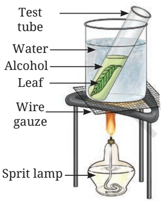
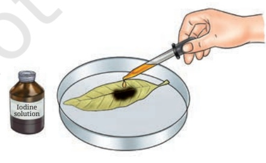

## FASCINATING FACTS

## फलकु समसु पदं ुिचता रोपणतो भवित के वलान् न यत: ।

“Trees do not produce fruits and flowers merely because they are planted.” This line is from an ancient Indian text named Vrikshayurveda. It records. It records useful observations about plant growth, soil, and agricultural practices touseful observations about plant growth, soil, and agricultural practices to help improve crop health, growth and production. The knowledge in thehelp improve crop health, growth and production. The knowledge in the text seems to be based on practical experiences and patterns seen overtext seems to be based on practical experiences and patterns seen over time. These ideas were then systematically documented to guide farmingtime. These ideas were then systematically documented to guide farming practices. For instance, there are references to different methods of organicpractices. For instance, there are references to different methods of organic manure preparation, such as mixing water, barley, and various seeds, likemanure preparation, such as mixing water, barley, and various seeds, like green, black, and horse grams.

## 10.2 How Do Plants Get Food for their Growth?

We know that animals get their food from plants, either directly by eating plants or indirectly by eating animals that in turn eat plants for their nutrition and growth. But how do plants obtain the food they need to grow? Unlike animals, plants do not eat food.

## 10.2.1 Leaves: the ̒ food factories̓of plants

Plants store food in the form of starch, a type of carbohydrate. This starch is produced in the leaves of a plant which, by design, are generally broad and flat. These are mostly green because of the presence of a green pigment called **chlorophyll**, that helps in capturing sunlight efficiently.

Let us find out the role chlorophyll plays in the preparation of food in the form of starch in plants.

## Activity 10.2: Let us check (demonstration activity)

(a) Boiling set-up

Fig. 10.2: Starch test in a leaf

(b) Iodine test

The teacher may demonstrate this activity.

Keep a leaf in boiling water for five minutes to soften it.

Dip this leaf in a test tube containing alcohol.

Place the test tube in a beaker containing boiling water. Wait until the leaf becomes colourless (Fig. 10.2a).