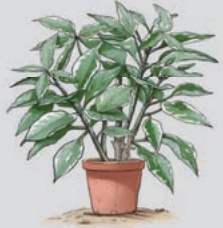
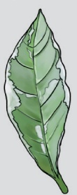
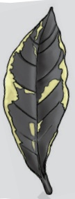
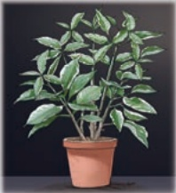
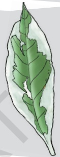
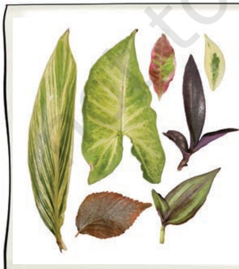
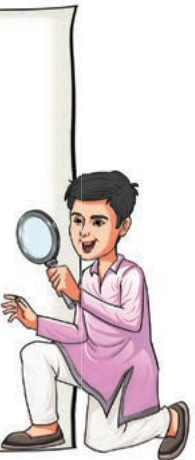

**Table 10.2: Presence of starch in green and non-green parts of the leaves of plants**

<table><tr><td>S.No.</td><td>Light conditions for potted plant</td><td>Initial colours before iodine test</td><td>Final colours after iodine test</td></tr><tr><td>1.</td><td>Plant kept in sunlight </td><td>Green and non-green patches on the leaf </td><td>Green patches of leaf turned blue-black </td></tr><tr><td>2.</td><td>Plant kept in the dark </td><td>Green and non-green patches on the leaf </td><td>No change in colour</td></tr></table>

In Table 10.2, Bhaskar recorded a blue-black colour (indicating the presence of starch) on the green patches of the leaf obtained from the plant placed in sunlight. Bhaskar also recorded that the leaf obtained from the plant kept in the dark does not show a blue-black colour, even on the green patches, indicating that no starch has been produced. Non-green patches of the leaf obtained from the plant placed in sunlight do not turn blue-black. Does it indicate that there is no chlorophyll present in those patches? The non-green patches may not have sufficient chlorophyll to prepare enough starch to be detected using the iodine test.

## FASCINATING FACTS

Some plant leaves appear red, violet, or brown because they contain more of these coloured pigments than theof these coloured pigments than the green-coloured chlorophyll. This hidesgreen-coloured chlorophyll. This hides the green colour. Some of these pigmentsthe green colour. Some of these pigments also help in photosynthesis. You can usealso help in photosynthesis. You can use an iodine test to check for the presencean iodine test to check for the presence of starch in these leaves, indicating thatof starch in these leaves, indicating that photosynthesis has indeed taken place.

