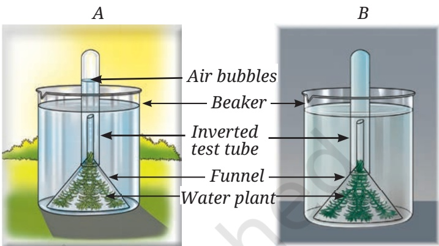
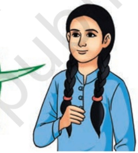
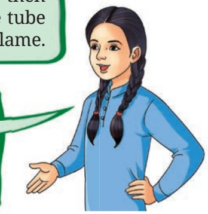

substances from their surroundings, or do they also release something? Let us explore this through an experiment performed by Barkha didi.

## Activity 10.5: Let us explore

Look at Fig. 10.4. **Compare** the two set-ups labelled as A and B, and analyse.

In Fig. 10.4, set-up A is placed in sunlight, and set-up B is placed in the dark. What difference do you observe in the two set-ups? Do you observe air bubbles emerging in the inverted test tube in set-up A? The gas produced in this set-up caused bubbles to emerge and get accumulated in the inverted test tube. Which gas is this?

Fig. 10.4: Activity showing the release of oxygen during photosynthesisof oxygen during photosynthesis

Oh yes! I remember. In our science lab, I have seen a similar set-up placed under sunlight near a window.

When sufficient gas was accumulated in the inverted test tube, Barkha didi placed her thumb on the mouth of the test tube while taking the test tube off the set-up. She then quickly inserted a lit matchstick into the tube and the matchstick produced an intense flame.

She inferred that the gas in the test tube is rich in oxygen. It indicates that oxygen is released during the process of photosynthesis. It also indicates that photosynthesis occurs in the presence of sunlight.

Based on Barkha didi’s experiment, we can conclude that oxygen is released during photosynthesis.