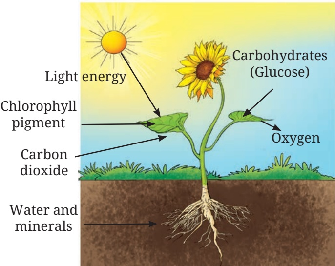
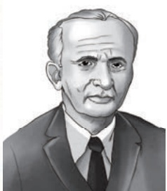

Fig. 10.5: A diagram showing photosynthesis

## 10.2.3 Photosynthesis: in a nutshell

We know that water, sunlight, carbon dioxide from the air, and chlorophyll are necessary to carry out the process of photosynthesis that produces carbohydrates (Fig. 10.5). During photosynthesis, food is actually produced in the form of glucose, a simple carbohydrate. This glucose not only serves as an instant source of energy but also later gets converted into starch for storage. The word equation of photosynthesis is given below —

$$
\mathrm{Carohoniide+Wafter\xrightarrow{Sunlight}Gluccesso}\ \mathrm{Gluccesso}\ \mathrm{Gxygen}
$$

## KNOW A SCIENTIST

Many scientists across the world contributed to develop an understanding of photosynthesis. In India, Rustom Hormusji Dastur (1896–1961) studied the process of photosynthesis. He was a plant scientist and served as the head of the Botany Department at the Royal Institute of Science, Bombay (now the Institute of Science, Mumbai), from 1921–1935. He studied effects of the amount of water and temperature on photosynthesis. He examined the importance of water, temperature, and the colour of light in the process of photosynthesis.

## 10.2.4 How do leaves exchange gases during photosynthesis?

We now know that photosynthesis requires carbon dioxide, and oxygen is released in the process. Which part of the plant helps in the exchange of carbon dioxide and oxygen? Let us **conduct** an activity to understand where the exchange of gases takes place.