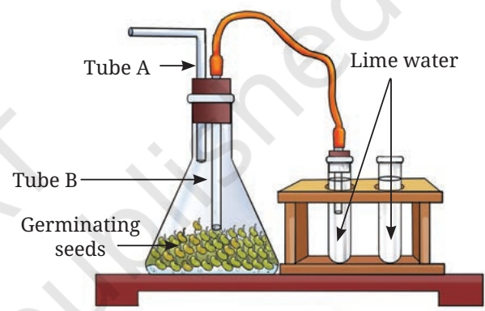

## 10.4 Do Plants Respire?

In the Grade 6 Science textbook Curiosity, chapter ‘Living Creatures: Exploring their Characteristics’, you learnt that all living beings respire. Do plants also respire like we do?

**Activity 10.8: Let us fi nd out (demonstration activity)**

Soak some moong bean seeds in water overnight.

Put a layer of cotton in a conical flask (Fig. 10.9) and moisten the cotton with water to keep it wet.

Place the soaked seeds over the wet cotton in the conical flask.

Cover the mouth of the conical flask with a cork having two holes.

Fit two tubes A and B through the two holes on the cork, as shown in Fig. 10.9.

Leave it undisturbed for 24 hours in the dark.

Take two test tubes and fill them with lime water.

Cover the mouth of one test tube with a cork having one hole in it.

Fig. 10.9: Set-up to test respiration in plants

Dip one glass tube in the test tube through a hole in the cork.

Connect the flask and test tube with a rubber pipe as shown in Fig. 10.9.

Compare both the test tubes for any change in colour. Does the lime water turn milky in both the test tubes? Why does the lime water turn milky in the test tube connected to the flask? Lime water turns milky due to the presence of more carbon dioxide in the flask. But where does this carbon dioxide come from? As we know, carbon dioxide is naturally present in very small quantities in the air. In the flask, additional carbon dioxide is produced by the seeds as they respire.

During respiration, glucose is broken down in the presence of oxygen, releasing carbon dioxide, water, and energy. The word equation for the proccess of respiration, is as follows —

Glucose + Oxygen Carbon dioxide + Water + Energy

The energy produced during respiration is used by plants for their growth and development. All parts of a plant, green or non-green, carry out respiration.

Thus, plants have different mechanisms for synthesising, transporting, and utilising food to get energy.