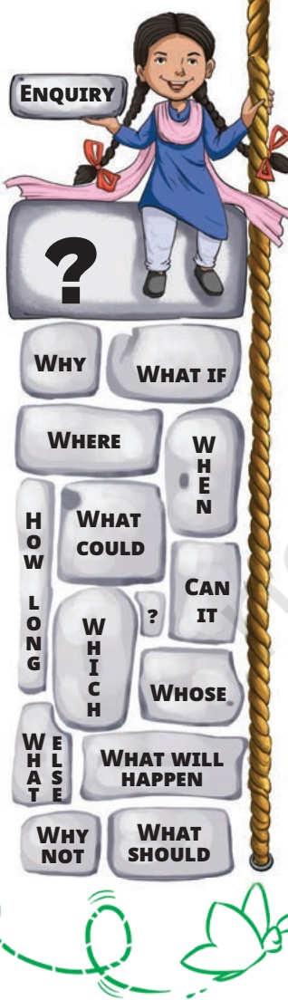

## In a Nutshell

All living organisms require food that provide energy for their growth and development.

Plants use carbon dioxide and water in the presence of sunlight and chlorophyll to produce glucose and oxygen. This process of synthesis of food is known as photosynthesis.

Leaves are the ̒ food factories ̓ of a plant.

Tiny pores on the surface of leaves, called stomata, help in the exchange of oxygen and carbon dioxide during photosynthesis and respiration.

The xylem transports water and minerals from roots, while the phloem carries food from leaves to all parts of the plants.

Plants break down glucose and release energy by a process called respiration. They use oxygen and release carbon dioxide in this process.

## Let Us Enhance Our Learning

## 1. Complete the following table

| S.No. | Feature Photosynthesis Respiration |
| --- | --- |
| 1. | Raw materials |
| 2. | Products |
| 3. | Word equation |
| 4. | Importance |

2. Imagine a situation where all the organisms that carry out photosynthesis on the earth have disappeared. What would be the impact of this on living organisms?

3. A potato slice shows the presence of starch with iodine solution. Where does the starch in potatoes come from? Where is the food synthesised in the plant, and how does it reach the potato?

4. Does the broad and flat structure of leaves make plants more efficient for photosynthesis? Justify your answer.

5. X is broken down using Y to release carbon dioxide, Z, and energy.

$$
\mathrm{X}+\mathrm{Y} \longrightarrow \mathrm{Caroon} \mathrm{dioxide}+\mathrm{Z}+\mathrm{Energy}
$$

X, Y, and Z are three different components of the process. What do X, Y, and Z stand for?