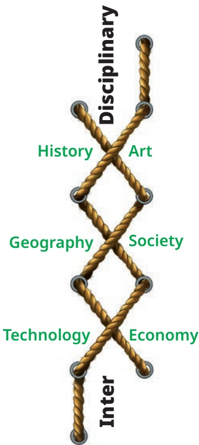
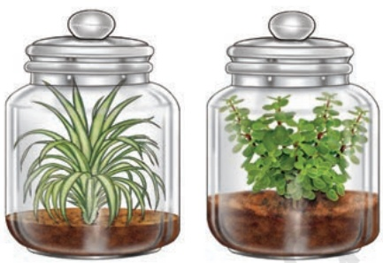

9. Design an experiment to observe if water transportation in plants is quicker in warm or cold conditions.

10. Photosynthesis and respiration are essential to maintain balance in nature. Discuss.

## Exploratory Projects

Develop a bottle garden by planting a growing plant like spider plant or jade plant in a large transparent bottle (Fig. 10.13). After growing the plant properly for some time, seal the mouth of the bottle. Observe the growth of the plant. If the plant is growing well that means the plant is maintaining the exchange of gases, that is, carbon dioxide produced in the process of respiration of the plant is utilised for performing photosynthesis, and oxygen generated in photosynthesis is utilised in respiration by the plant inside the bottle.

Fig. 10.13: Bottle garden

How are plant processes like photosynthesis, respiration, and water and food transportation crucial for crop production?

Visit a greenhouse, if there is one near your place. Observe how people grow plants in a green house. Find out how they regulate the amount of light, water, and carbon dioxide used to grow plants.

## KNOW A SCIENTIST

Kamala Sohonie (1911–1998) was a woman scientist of India. She received a Ph.D. degree for her remarkable contribution in the area of respiration in plants from Cambridge University. She returned to India and worked at the Lady Hardinge Medical College in New Delhi, and later at the Nutrition Research Laboratory, Coonoor. Thereafter, she moved to the then Royal Institute of Science, Bombay, where she was eventually appointed as Director. Much of her work helped improve the nutritive values of plant foods. She also worked on the sap of the coconut palm as a nutritive drink called Neera.

