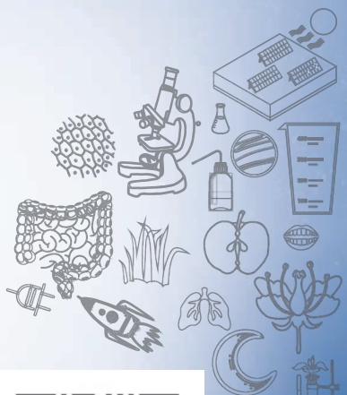
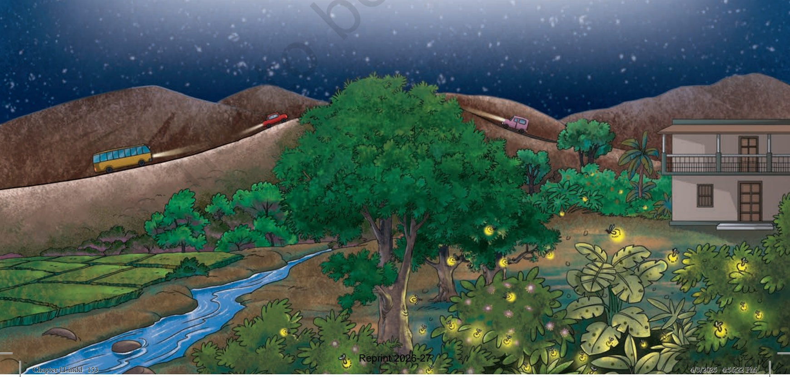

# Light: Shadows and Reflections

In the Western Ghat region of Maharashtra, Keshav spends part of his summer vacation at his friend Jatin’s grandparents’ village. Having lived in a big city, he finds the forests, fresh air, sounds of gushing streams, and chirping birds a novel experience.

However, for Keshav, the most fascinating sight is the dance of hundreds of fireflies at night, flashing their lights in a wonderful performance. Jatin’s grandparents explain that fireflies are seasonal insects and they use light to communicate. Unfortunately, Keshav also learns the number of fireflies is decreasing due to light pollution, reduced forest cover, and excessive tourism.

At the end of their vacation, Keshav and Jatin board an evening bus back to their city. As the bus winds through the hilly roads, Keshav watches the moonlit landscape and the beams from the headlights of passing vehicles flashing by. He is reminded of the many poems and songs about moonlight, and wonders — does the Moon actually produce its own light? Did we not learn in the chapter ‘Beyond Earth’ in the Grade 6 Science textbook Curiosity that all other objects in our solar system shine only by reflecting the light of the Sun? Is moonlight just reflected sunlight? Which objects give off their own light? While thinking, he notices something strange — light seems to move in a straight line!

0777CH11

