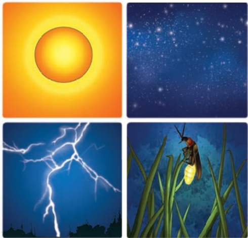
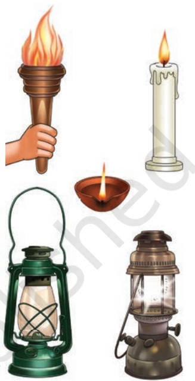
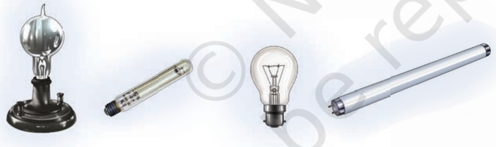
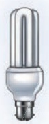
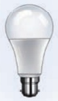
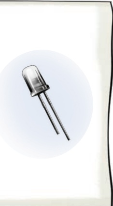

Fig. 11.1: Some natural sources of light

## 11.1 Sources of Light

The Sun gives out or emits its own light and is the main source of natural light on the Earth. Stars, lightning, natural fire, and certain animals also emit their own light (Fig. 11.1).

In ancient times, humans learnt to create fire — the earliest form of artificial lighting. With

time, they learnt to create fire using different fuels, such as animal fat, oil, wax, and gas (Fig. 11.2).

With the invention of electricity and different kinds of electric light sources, most of the lighting needs of humans are now met by electric lighting (Fig. 11.3).

Objects that emit their own light are called **luminous** objects. Objects that do not emit their own light are called **non-luminous** objects. The Moon is a  objects. The Moon is a non-luminous object. It does not emit itsnon-luminous object. It does not emit its own light. It just reflects the light emittedown light. It just reflects the light emitted by the Sun that falls on it.by the Sun that falls on it.

Fig. 11.2: Fire as a source of artificial light

Fig. 11.3: Some sources of electric light

## SCIENCE AND SOCIETY

Light Emitting Diode (LED) lamps are modern light sources that consume much less power, are brighter and last longer than traditional lamps. This notand last longer than traditional lamps. This not only reduces electricity bills but is also better foronly reduces electricity bills but is also better for environment. Recognising their advantages, theenvironment. Recognising their advantages, the Indian government has made substantial efforts toIndian government has made substantial efforts to promote the use of LED lamps nationwide. At theirpromote the use of LED lamps nationwide. At their end of life, LED lamps must be appropriately disposedend of life, LED lamps must be appropriately disposed or recycled, and not thrown in the garbage.or recycled, and not thrown in the garbage.

