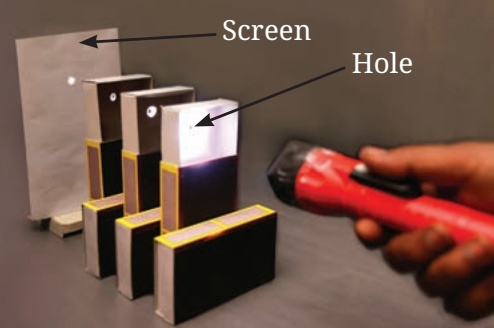
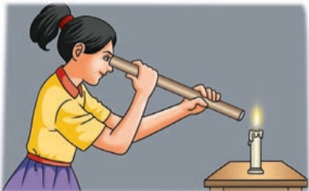
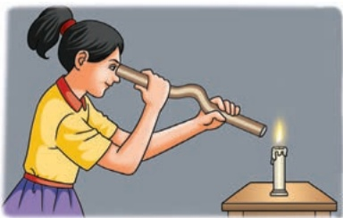

## 11.2 Does Light Travel in a Straight Line?

Let us do an activity to try to find out.

## Activity 11.1: Let us investigate

Take three matchboxes and make a hole in the inner tray of each matchbox, exactly at the same position.

Arrange these three matchboxes in a straight line. Make sure that all three holes are exactly at the same height and are in a line as shown in Fig. 11.4.

Fig. 11.4: Matchbox activity— light through holes

Place a torch light on one side of the matchboxes, ensuring that its lamp is at the height of the holes.

Place a cardboard (screen) on the other side of the matchboxes and obtain a bright spot on it. (You may need to slightly adjust the heights of boxes.)

Move one of the matchboxes slightly to a side or up and down. Are you able to obtain the light spot on the screen now?

When all the three holes are not in the same line, we could not obtain the light spot on the screen. These observations suggest that light travels in a straight line.

I have an idea. Let us try to see the candle flame through a bent pipe!

Should we also try out this idea?

## Activity 11.2: Let us explore

**Caution** — Use a lighted candle under adult supervision only.

Take a long hollow pipe of some flexible material and align it so that you can see the candle flame as shown in Fig. 11.5a.

Now, bend the pipe and try to see the candle flame again (Fig. 11.5b). Can you still see it?

You could see the candle flame through a straight pipe but not through a bent pipe. This shows that light travels in a straight line. Fi

(a)

(b)

Fig. 11.5: Viewing candle flame through (a) a straight pipe (b) a bent pipe