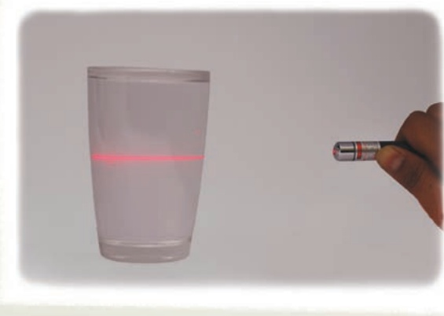
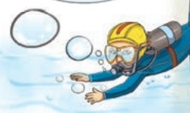
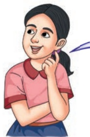

A

**Caution** — Use a laser only under teachers’ supervision. Avoid— Use a laser only under teachers’ supervision. Avoid using high-power lasers for this activity; a low-power laserusing high-power lasers for this activity; a low-power laser pointer is sufficient. Never point the laser beam directly atpointer is sufficient. Never point the laser beam directly at anyone’s eyes, as it can cause serious eye damage.

**D** <strong>IVE</strong> **EEPER**

Pass a laser beam through a beaker filled with water in which a drop of milk is added to make the laser beam easily visible.

What do you observe? Do you see that the beam of laser light inside water follows a straight path?

However, light can sometimes even bend around corners! This is something you will learn in the higher grades.

## 11.3 Light through Transparent, Translucent, and Opaque Materials

What happens when an object comes in the path of light?

Let us place objects made of different materials in the path of light and find out.

**Activity 11.3: Let us experiment**

Collect objects made of different materials. Also, you will need a torch.

**Table 11.1: Light through different materials**

<table><tr><td rowspan=2>Material</td><td rowspan=2>Transparent/Translucent/Opaque</td><td colspan=2>Light will passfully/partially/not at all</td></tr><tr><td>My prediction</td><td>My observation</td></tr><tr><td>Cardboard</td><td></td><td></td><td></td></tr><tr><td>Paper</td><td></td><td></td><td></td></tr><tr><td>Glass</td><td></td><td></td><td></td></tr><tr><td>Tracingpaper</td><td></td><td></td><td></td></tr><tr><td>Thick cloth</td><td></td><td></td><td></td></tr><tr><td></td><td></td><td></td><td></td></tr><tr><td></td><td></td><td></td><td></td></tr></table>