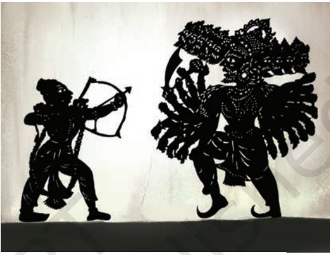

to observe a shadow. The walls, floor, ground, or any other surface acts as a screen for observing shadows in our daily life.

The shape, size, and sharpness of the shadow depend on the position of the object relative to the light source and the screen. The shadows may give information about the object or we may not be able to guess the object at all. Changing the colour of opaque objects does not change the colour of the shadows.

## FASCINATING FACTS

Shadow play, or shadow puppetry, has been a part of our cultural heritage for centuries. In this art form, flat cut-out figures called shadow puppets are placed between a light source and a screen. By moving the puppets and the light, puppeteers can create life-like movements, bringing the characters to life. Different regions have their own unique styles, like the Charma Bahuli Natya in Maharashtra, Keelu

Bomme and Tholu Bommalata of Andhra Pradesh, Togalu Gombeyaata in Karnataka, Ravana Chhaya in Odisha, Tholpavakoothu in Kerala, and Bommalattam in Tamil Nadu. These are used not only for entertainment but also communicate important messages to the community.

## 11.5 Reflection of Light

When the opaque object was a shiny object like a polished steel plate, I got a shadow on the screen, but I also saw that there was a bright spot of light on the wall on the opposite side. Why was it so?

## Activity 11.5: Let us investigate

Find a shiny flat steel plate or a plane mirror, that is, a mirror that is flat and not curved.

Take it outside and let the sunlight fall on the shiny surface. What can you do to redirect light on the wall on which the sunlight is not falling directly?