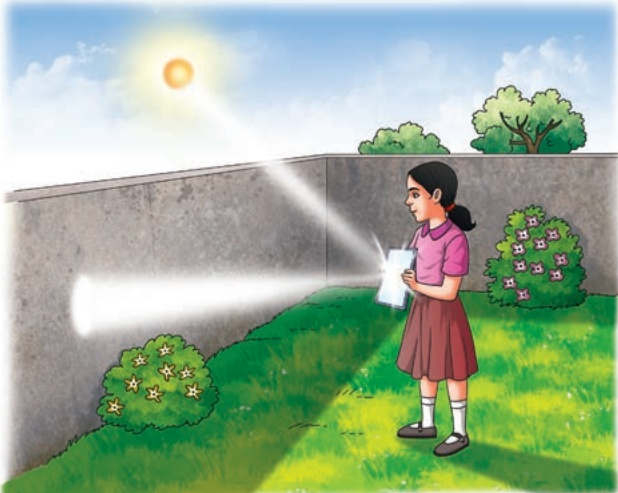
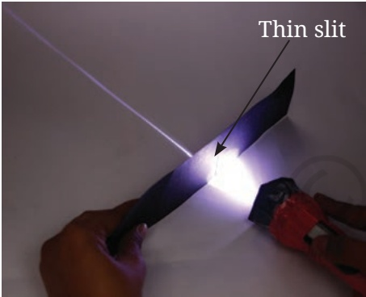
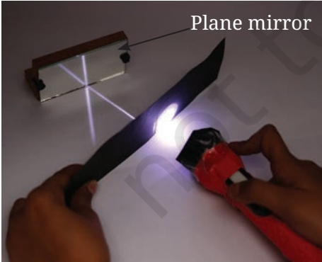

Fig. 11.8: Using mirror to redirect sunlight on a wall

Turn the shiny plate or mirror in different directions to redirect the light onto a wall or a nearby surface (Fig. 11.8). Do you see a spot of light on the wall? Does it mean that the shiny plate or mirror has changed the direction of light?

Now, tilt the shiny plate or mirror in different ways and observe the light spot on the wall. Does it change position? Notice how light always travels in straight lines and changes direction when it falls on the shiny plate or mirror.

What conclusion do you draw from your observations? This activity suggests that a shiny surface or a mirror changes the direction of light that falls upon it. This change in direction of light by a mirror is called the **reflection of light**. Let us try to understand the reflection of light by a mirror.

## Activity 11.6: Let us experiment

(a)

(b)

Fig. 11.9: (a) A light beam (b) Reflection of light in a plane mirror

Take a plane mirror with stand, a torch, a comb, a sheet of white paper, and a strip of black paper.

Using the black paper, close all openings of the comb, except for one to make a thin slit.

Spread a white paper on a table, hold the comb perpendicular to the sheet of paper and shine the torch light on the slit. Adjust the comb and torch slightly till you see a thin beam of light along the paper which has passed through the slit (Fig. 11.9a).

Now, place the mirror in the path of the light beam while keeping the comb steady (Fig. 11.9b). What do you observe?

The path of the light beam is changed after falling on the mirror. The reflection of light occurs at the mirror.

In a mirror, I can also see my face. Is that also due to the reflection of light?

