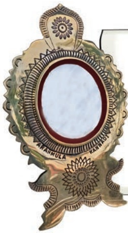

You might have noticed that when you stand close to the plane mirror, the image also appears to be close to the mirror. The image appears to be far from the mirror when you stand far from the plane mirror.

Raise your left arm. Which arm does your image raise?

Touch your right ear. Which ear does your image touch?

You find that your left appears right in your image and your right appears left in your image. This type of perceived left-right reversal is called **lateral inversion**. There is lateral inversion in the images formed by a plane mirror.

Oh! Now I realise why ‘ ̓ is written on an ambulance. It reads ‘AMBULANCE ̓ when viewed from the rear-view mirrors of the vehicle ahead of the ambulance.

## FASCINATING FACTSFASCINATING FACTS

When mirrors were invented is not known. Earlier, mirrorsWhen mirrors were invented is not known. Earlier, mirrors were made by polishing stone or metal. When glass mirrorswere made by polishing stone or metal. When glass mirrors started being made, the art of making metal mirrors got loststarted being made, the art of making metal mirrors got lost gradually. However, it still survives, for example, in Kerala,gradually. However, it still survives, for example, in Kerala, where Aranmula Kannadi, a unique metal surface mirror haswhere been made for centuries.been made for centuries.

Can we see an image of an object only in a mirror or are there some other ways as well?

## 11.7 Pinhole Camera

A pinhole camera is a device in which the light rays from an object pass through a tiny hole (a pinhole) and form an image on a screen.

