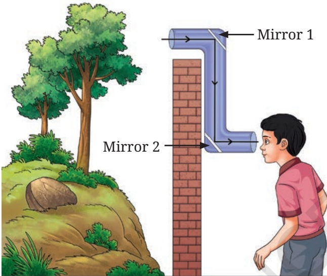
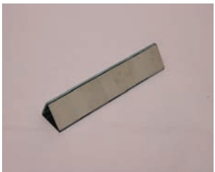
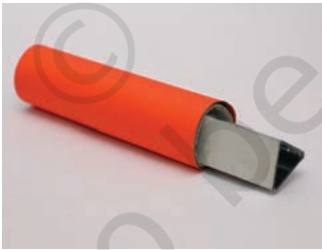
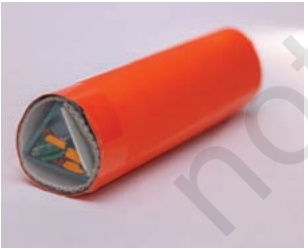
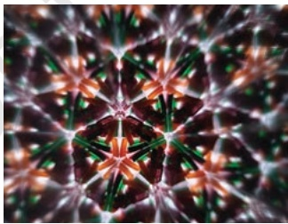
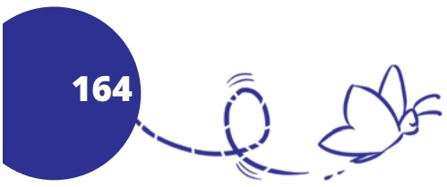

## 11.8 Making Some Useful Items11.8 Making Some Useful Items

After having learnt that light travels in a straight line and is reflected by mirrors, it is time to **create** some useful items based on this learning.

Fig. 11.14: A periscope

(a)

(b)

(c)

(d)

Fig. 11.15: A kaleidoscope

## 11.8.1 Periscope

We can make a simple periscope by placing two plane mirrors in a Z-shaped box as shown in Fig. 11.14.

Reflection from two mirrors enables us to see objects that are not visible directly. Periscopes are used in submarines, tanks, or by soldiers to see outside their bunkers. You may use it to look ahead when standing behind taller friends.

## 11.8.2 Kaleidoscope

Get three rectangular plane mirror strips of equal width and join them together in a triangular manner as shown in Fig. 11.15a. You may use three strips of thick reflective paper instead of mirrors. Fix these in a circular tube of thick chart paper (Fig. 11.15b). On one end of the tube, fix a transparent plastic sheet using a rubber band or an adhesive tape. Place several broken pieces of coloured bangles or beads on this (Fig. 11.15c), and cover it with a tracing paper using a rubber band or an adhesive tape.

When you peep through the open side, you view a beautiful pattern (Fig. 11.15d). Even if you leave both sides of the kaleidoscope open and