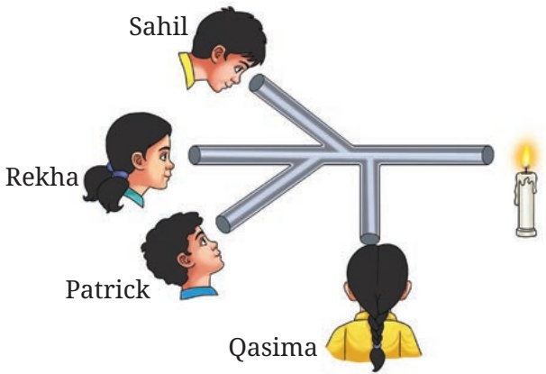
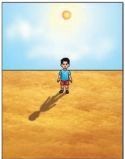
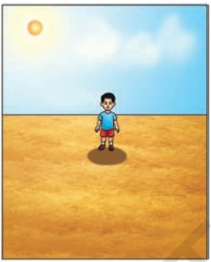
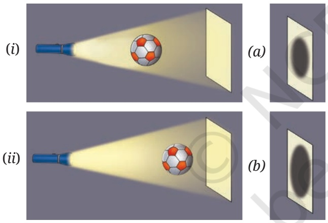
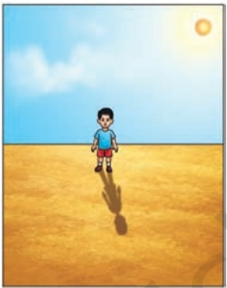
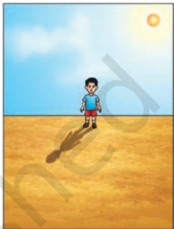
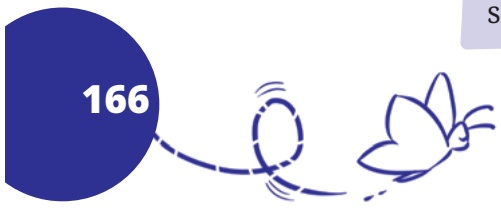

Fig. 11.16

(a)

3. Sahil, Rekha, Patrick, and Qasima are trying to observe the candle flame through the pipe as shown in Fig. 11.16. Who can see the flame?

4. Look at the images shown in Fig. 11.17 and select the correct image showing the shadow formation of the boy.

(b)

Fig. 11.18

Fig. 11.17

(c)

(d)

5. The shadow of a ball is formed on a wall by placing the ball in front of a fixed torch as shown in Fig. 11.18. In scenario (i) the ball is closer to the torch, while in scenario (ii) the ball is closer to the wall. Choose the most accurate representation of the shadows formed in both scenarios from the options provided (a and b).

6. Based on Fig. 11.18, match the position of the torch in Column A with the characteristics of the ball’s shadow in Column B.

| Column A | Column B |
| --- | --- |
| If the torch is close to the ball | The shadow would be smaller |
| If the torch is far away | The shadow would be larger |
| If the ball is removed from the set-up | Two shadows would appear on the screen |
| If two torches are present in the set-up on the left side of the ball | A bright spot would appear on the screen |

