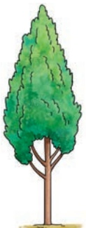
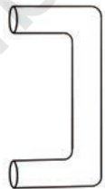
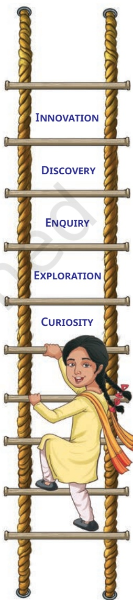

7. Suppose you view the tree shown in Fig. 11.19 through a pinhole camera. Sketch the outline of the image of the tree formed in the pinhole camera.

8. Write your name on a piece of paper and hold it in front of a plane mirror such that the paper is parallel to the mirror. Sketch the image. What difference do you notice? Explain the reason for the difference.

Fig. 11.19

9. Measure the length of your shadow at 9 AM, 12 PM, and 4 PM with the help of your friend. Write down your observations:

(i) At which of the given times is your shadow the shortest?

(ii) Why do you think this happens?

10. On the basis of following statements, choose the correct option.

**Statement A**: Image formed by a plane mirror is laterally inverted.

**Statement B**: Images of alphabets T and O appear identical to themselves in a plane mirror.

(i) Both statements are true

(ii) Both statements are false

(iii) Statement A is true, but statement B is false

(iv) Statement A is false, but statement B is true

11. Suppose you are given a tube of the shape shown in the Fig. 11.20 and two plane mirrors smaller than the diameter of the tube. Can this tube be used to make a periscope? If yes, mark where you will fix the plane mirrors.

Fig. 11.20

12. We do not see the shadow on the ground of a bird flying high in the sky. However, the shadow is seen on the ground when the bird swoops near the ground. Think and explain why it is so.

## Exploratory Projects

Have you ever seen a firefly where you live? If no, ask your elders if fireflies were seen earlier in your region. If yes, find out the reasons for their not being seen anymore. Develop a story about it.

Repeat Activity 11.4, but this time cover the face of the torch with a coloured transparent paper and observe the colour of

**INNOVATION**

**DISCOVERY**

**EXPLORATION**

**CURIOSITY**

