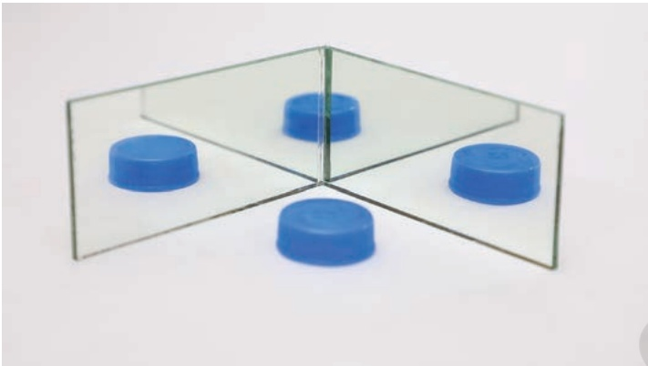

the shadow. Repeat this using transparent paper of different colours. Report your conclusions.

A plane mirror forms only a single image of an object. But what will happen if two or more mirrors are kept at an angle with each other or parallel to each other? Find out by placing two mirrors as shown in Fig. 11.21.

Fig. 11.21: Observing images in two mirrors

You are given a small piece of a plane mirror. Can this piece form an image of an object much larger than the mirror, like a large tree? Think and predict. Then carry out the activity.

## FASCINATING FACTS

Light emitted by the Sun takes about 8 minutes and 20 seconds to reach the Earth. Hence, if the Sun were to suddenly stop emitting light, we would not know that for another 8 minutes 20 seconds.

