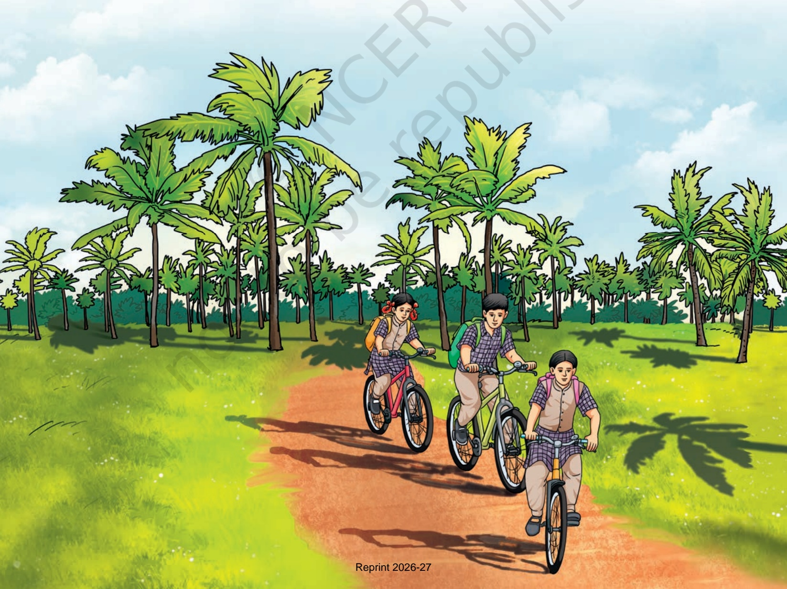

i g in Kanniyakumari, Tamil Nadu, 12-year-old Rashmika was eagerly cycling to school. She was excited. That was the day her science teacher had dedicated a class for students to share and try to explain interesting observations.

Rashmika had been noticing that the coconut tree shadows were long in the morning but shorter in the afternoon on her way back. She thought about it and decided that the size of the shadows changed because the Sun moved across the sky during the day. But she also remembered learning that the Earth moved around the Sun (in chapter ‘Beyond Earth’ in the Grade 6 Science textbook Curiosity) so she was puzzled. She wondered — does the Sun move in the sky? Or does the Earth move?

0777CH12

