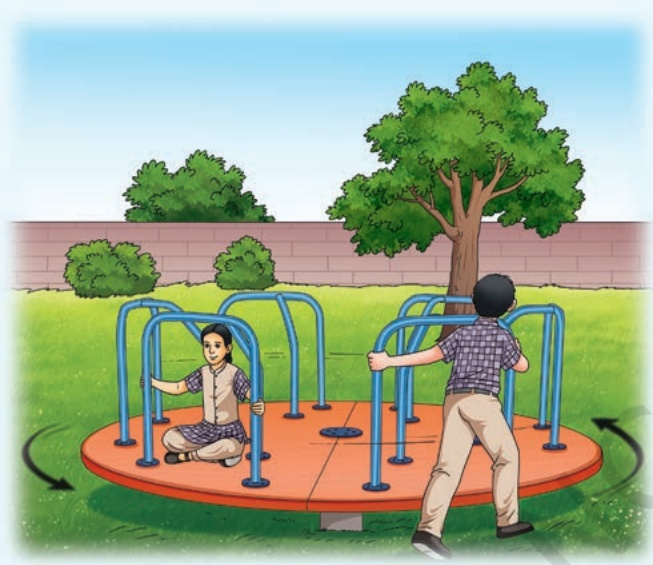

## 12.1 Rotation of the Earth

You might have also noticed that the Sun rises in the East and sets in the West. Have you ever wondered why? Let us try to understand why. Have you ever enjoyed riding a merry-go-round at a park or at your school? Let us go back to riding a merry-go-round!

**Activity 12.1: Let us explore**

Sit on a merry-go-round facing towards the outer side as shown in Fig. 12.1.

Fig. 12.1: A girl observing objects around her while riding a merry-go-round

Ask someone to turn the merry-goround slowly in the anti-clockwise direction as shown in Fig. 12.1. While you are sitting on the moving merrygo-round, look around you. Do the objects around you appear to be moving? In which direction do they appear to be moving?

While you turn in the anti-clockwise direction, the objects appear to turn around you in the opposite direction, that is, in the clockwise direction.

Now fix your gaze at a particular tree (or a building) ahead of you while sitting on the merry- go-round turning around in anti-clockwise direction.

In which direction do you find the tree turning around you? Is it in your view all the time?

The tree appears to turn around you in the opposite direction, that is, the clockwise direction. The tree appears in your view from your left-hand side and then moves out of your view on the right-hand side when you view it from a merry-go-round turning around in anti-clockwise direction.

Using the observations made by us while riding a merry-goround, let us now think. When we view from the Earth, the Sun appears in the East, moves across the sky from the East to the West and disappears in the West. Does it indicate that the Sun is moving in the sky? Or might it be that the Earth itself is turning around and the Sun just appears to move?

The fact is that the Sun appears to be moving because we view it from the Earth, which is turning around itself.