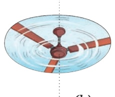
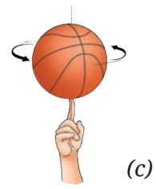
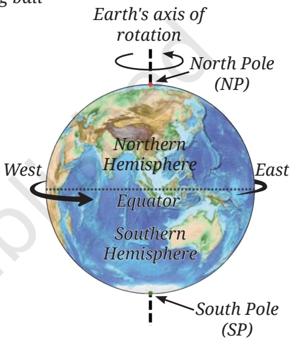
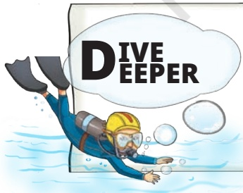
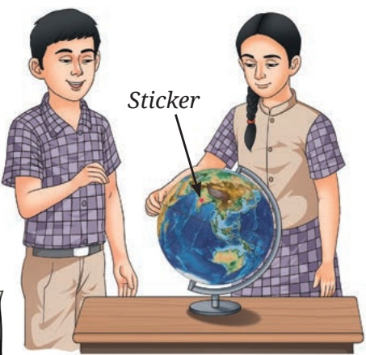

In which way is the Earth turning around itself? To visualise this, let us recall some of the objects which turn around themselves. Have you watched a top spinning around its spindle (Fig. 12.2a)? Or a spinning fan (Fig. 12.2b)? Or tried spinning a ball (Fig. 12.2c)?

(b)

Fig. 12.2: (a) A spinning top (b) A spinning fan (c) A spinning ball

In a similar manner, the Earth also spins (or **rotates**) on its own axis in space as shown in Fig. 12.3. The **Earth’s axis of rotation** passes through its geographic North Pole and the South Pole. The Earth completes **one rotation** in about 24 hours.

When viewed from the top of the North Pole (Fig. 12.3), the Earth is rotating in the anti-clockwise direction, that is, from West to East.

Let us try to understand this with the help of a globe. You have used a globe in Grade 6 to represent the Earth and identified North Pole, South Pole, and Equator on it. You also learnt that its axis passed through its North and South poles (in the Grade 6 Social Science textbook Exploring Society India and Beyond).

(a)

Fig. 12.3: Rotation of the Earth

## Activity 12.2: Let us explore

™ Use a globe to represent the Earth and place a small sticker to mark your location on it (Fig. 12.4a).

™ While viewing from above the North Pole, slowly rotate the globe on its axis in anti-clockwise direction.

™ **Observe** how your location turns around and finally comes back to its original position completing one rotation.

Rotation is the motion of an object in which all its parts move in circles around an imaginary line that passes through it. This line is called the axis of rotation.

Fig. 12.4(a): Using a globe to understand rotation of the Earth