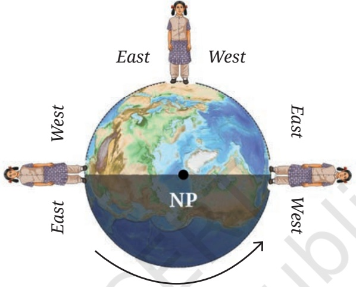
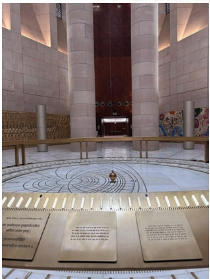

Now **imagine** that you are standing on the Equator on the Earth and watching the sky during one rotation of the Earth while it rotates from West to East. What will you observe? Will your observation be the same as that of the girl shown in Fig. 12.6?

2. Around noon, I have rotated to a new position where the Sun is now over my head.

3. By evening, I have rotated further. The Sun has started to disappear from my view to the left from the West. The stars will now become visible in the night sky.

1. I am facing North and my back is to the South. The morning Sun appears in my view to my right in the East.

Fig. 12.6: A girl on the rotating Earth viewing the Sun from the Equator

Due to the rotation of the Earth, the Sun appears to rise in the eastward direction, move across the sky from the East to the West and set in the westward direction (Fig. 12.6). Then the night begins and the stars become visible in the sky.

## FASCINATING FACTS

In an earlier chapter ‘Measurement of Time and Motion’, you learnt how the scientist Galileo discovered an important property of a pendulum, and in the seventeenth century, another scientist, Huygens, used that property to make pendulum clocks that measured time. In the middle of nineteenth century, another scientist, Leon Foucault, used a long pendulum to give the first simple demonstration of the Earth’s rotation. The pendulum, known as a Foucault pendulum in hispendulum, known as a Foucault pendulum in his honour, consists of a long string with a heavy bob,honour, consists of a long string with a heavy bob, suspended from a high ceiling.suspended from a high ceiling.

A Foucault pendulum with a length of 22 metres has been hung from a skylight in the Constitutionhas been hung from a skylight in the Constitution Hall of the new Parliament building in New Delhi,Hall of the new Parliament building in New Delhi, India. It symbolises the integration of the idea ofIndia. It symbolises the integration of the idea of India with the vastness of the cosmos.India with the vastness of the cosmos.

