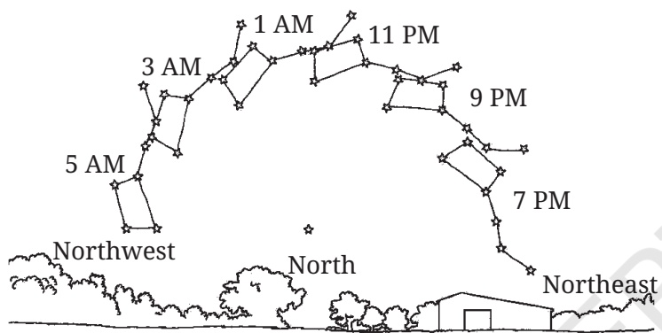
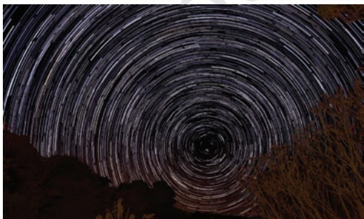

Since the Earth is rotating, shouldn’t the stars also appear to move in the sky like the Sun?

**Activity 12.3: Let us explore** Yes, indeed! Let us look at the stars in the night sky to see the effect of Earth’s rotation.

On an early evening between March and May, **identify** the Big Dipper (Saptarishi), and the Pole Star (Dhruva Tara), if visible, as you did in the chapter ‘Beyond Earth’ in the Grade 6 Science textbook Curiosity.

Fig. 12.7: Illustrative sketch of Big Dipper (for activity 12.3) by a student located in Pune on the night of 1–2 April

Note down your location and date of your night sky observations. The activity must be carried out on the same night.

**Draw** the orientation of the Big Dipper in the sky with respect to the Pole Star (or a fixed tree/building on the ground in a direction towards the Big Dipper if you cannot see the Pole Star). Mark the time of your observation along with your sketch as shown in Fig. 12.7.

After two hours, observe the Big Dipper again. Has it moved? Again, draw its orientation and note down the time.

Repeat the above step after two hours. Do you observe that the Big Dipper appears to move around the Pole Star (notice just the movement even if you cannot see the Pole Star)?

The Earth’s axis of rotation points very close to the Pole Star in the Northern Hemisphere. Therefore, the Pole Star appears nearly stationary in the sky from the Earth. All the stars appear to move around it. Just like the Sun, the Moon also appears to rise in the eastward direction and set in the westward direction because the Earth rotates from West to East.

(Picture taken from Mahuli, Maharashtra)

## FASCINATING FACTS

Astrophotographers take long exposure photographs, keeping the camera’sphotographs, keeping the camera’s shutter open for a long time. In suchshutter open for a long time. In such a photograph, the apparent motion ofa photograph, the apparent motion of the stars is recorded as arcs of a circle,the stars is recorded as arcs of a circle, known as star trails.

