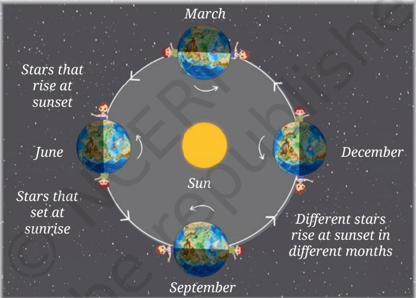

The path an object takes while revolving around another object is called its **orbit**. If viewed from the top (Fig. 12.8), the orbit of the Earth around the Sun is nearly circular. (In the figure of the Solar System given in chapter ‘Beyond Earth’ in the Grade 6 Science textbook Curiosity, the orbit appeared elongated because it was a side view of the orbit). The Earth completes **one revolution** around the Sun in about 365 days and 6 hours.

## 12.2.1 Changing view of night sky from the Earth

Every evening the Sun sets in the westward direction and the night sky becomes visible. We know that this occurs due to the Earth’s rotation. As the Earth also revolves around the Sun continuously, the stars seen in the night sky after sunset gradually change over a year as we look in different directions, as shown in Fig. 12.8.

Fig. 12.8: Revolution of the Earth around the Sun leads to changing view of the night sky throughout the year (The sizes and distances are not to scale)

You can also notice this change by looking at the pattern of stars (such as those that you learnt about in Grade 6), at a fixed time of the night, on days separated by a month.

## FASCINATING FACTS

The Bhil and Pawara are indigenous communities from the Tapi Valley in western India, who used the appearance of certain patterns of stars in the sky as markers for the arrival of monsoon rain.