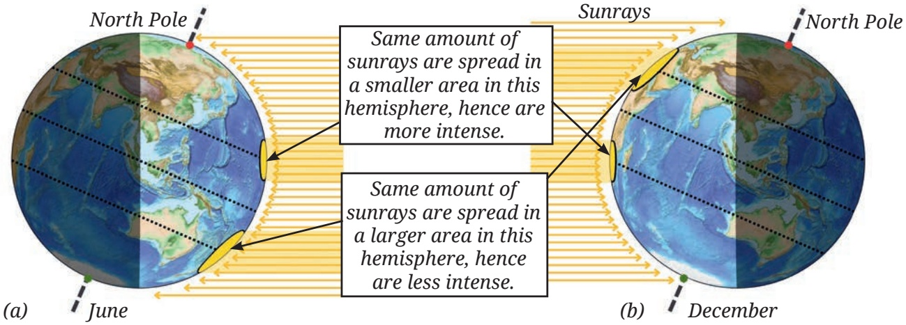
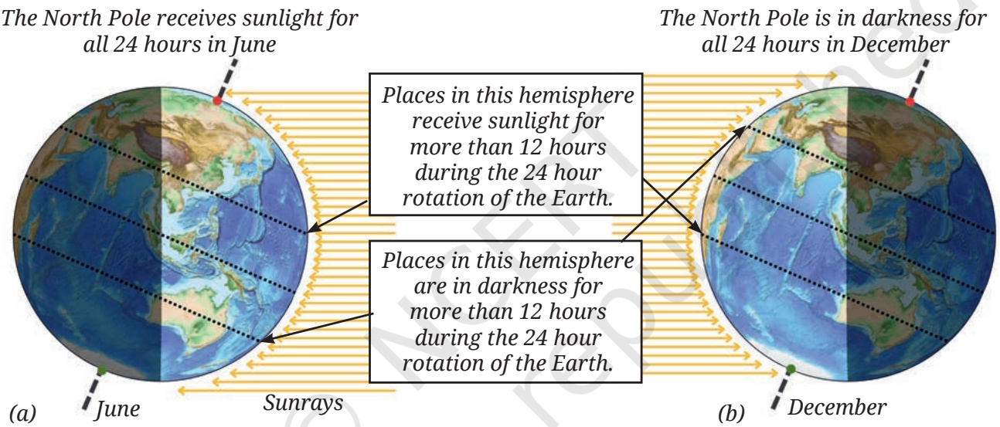

Fig. 12.10: (a) More intense sunlight in the Northern Hemisphere and less intense sunlight in the Southern Hemisphere in June (b) The opposite situation happens in December.

Fig. 12.11: In the Northern Hemisphere (a) Longer daytime in June (b) Shorter daytime in December

The seasons and length of daytime are reversed in the Southern Hemisphere as compared to the Northern Hemisphere. There, it is winter in June and summer in December (Fig. 12.10 and Fig. 12.11).

## DD IVEIVE EEPEREEPER

Two incorrect reasons often given to explain why seasons occur on the Earth are:on the Earth are:

X When the Northern Hemisphere tilts towards the Sun, it is closer to the Sun.

The orbit of the Earth is an oval with the Sun slightly displaced from its centre so the Earth is at different distances from the Sun over the year.

However, the difference in distances in either of these cases isHowever, the difference in distances in either of these cases is very small and these are not the reasons why seasons occur on the Earth. In fact, the Earth is closest to the Sun in January.