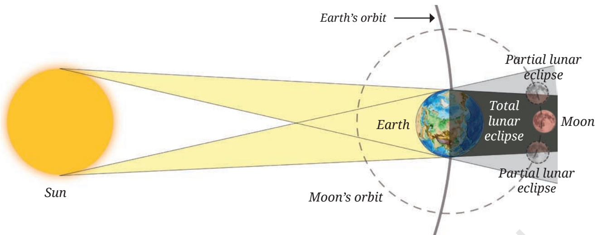
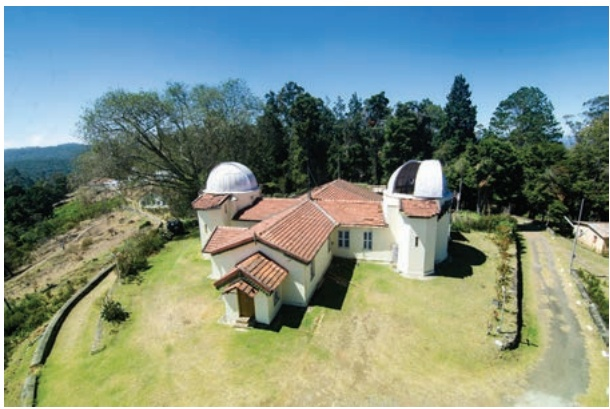

Fig. 12.16: Geometry of lunar eclipse (The sizes and distances are not to scale in the figure)

When the Moon is completely in the Earth’s shadow, it is called a **total lunar eclipse**. The bright disc of the Moon starts to appear dark red in colour and stays that way until the Moon moves out of the shadow of the Earth. When part of the Moon is in the Earth’s shadow and the rest of the Moon is visible, it is called a **partial lunar eclipse**. Unlike the Sun, we can safely watch the eclipsed full Moon with our naked eye.

## SCIENCE AND SOCIETY

Using the computer version of Stellarium app, which is free, you may get information about the upcoming solar and lunar eclipses (if any) which may be visible from your location.

## FASCINATING FACTS

The Kodaikanal Solar Observatory is located in the beautiful Palani range of hills in southern India. It washills in southern India. It was established in 1899 and hasestablished in 1899 and has provided data about the Sun forprovided data about the Sun for over 100 years. It is operatedover 100 years. It is operated by the Indian Institute ofby the Indian Institute of Astrophysics (IIA), Bengaluru.Astrophysics (IIA), Bengaluru.

