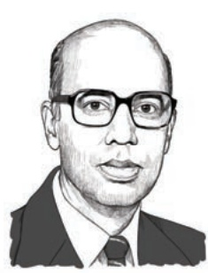
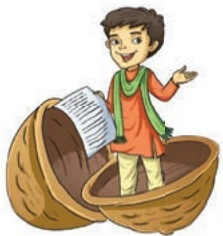
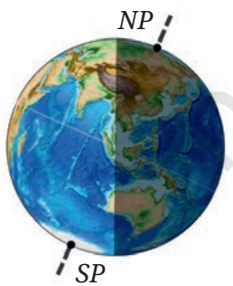

## KNOW A SCIENTIST

M.K. Vainu Bappu is known as the father of modern Indian astronomy. He led efforts in setting up many instruments and telescopes in India, such as the telescopes at Manora Peak near Nainital (Uttarakhand) and Kavalur (Tamil Nadu). The observatory at Kavalur has been named after him. He mainly studied stars and even discovered a comet. He also travelled to different parts of the world to study solar eclipses.

## In a Nutshell

## Cwmwamam

The Earth rotates on its own axis in about 24 hours.

The Earth’s rotation from West to East causes day and night as well as the apparent motion of the Sun, the Moon, and the stars.

The Earth revolves around the Sun and takes nearly 1 year to complete a revolution.

The Earth’s axis of rotation is not upright with respect to the orbit, but is tilted.

Seasons occur because of the tilt of the Earth’s axis of rotation and its spherical shape.

A solar eclipse occurs when the Moon is in the path of the Sun as seen from the Earth, and sunlight is blocked from reaching the Earth.

A lunar eclipse occurs when the Earth comes in between the Sun and the Moon, blocking sunlight from reaching the Moon.

## Let Us Enhance Our Learning

Fig. 12.17

1. In Fig. 12.17, how many hours of sunlight do the North Pole and the South Pole receive during one rotation of the Earth?

2. Fill in the blanks

(i) Stars rise in the and set in the

(ii) Day and night are caused by the Earth’s

(iii) When the Moon fully covers the Sun from our view, it is called a solar eclipse.