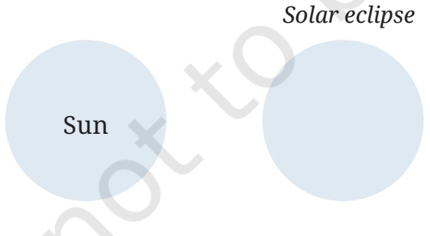
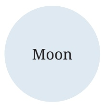
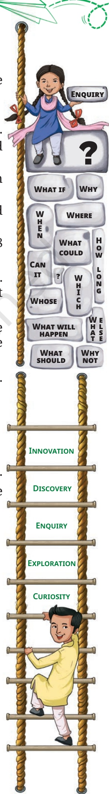

## 3. State whether True or False

(i) Lunar eclipse occurs when the Sun comes between the Earth and the Moon.

(ii) Sunrise happens earlier in Gujarat than in Jharkhand.

(iii) In Chennai, the longest day occurs on the summer solstice.

(iv) We should watch the solar eclipse directly with our naked eye.

(v) Seasons occur due to the tilt of Earth’s axis of rotation and its spherical shape.

(vi) The Earth’s revolution around the Sun causes day and night.

4. Padmashree saw the Orion constellation nearly overhead at 8 pm yesterday. When will she see Orion overhead today?

5. Nandhini saw a group of stars rising at midnight on 21 June. When will she see the same group of stars rising at midnight next year?

6. Abhay noticed that when it was daytime in India, his uncle who was in the USA was generally sleeping as it was night-time there. What is the reason behind this difference?

7. Four friends used the following ways to see the solar eclipse. Who among them was being careless?

(i) Ravikiran used a solar eclipse goggle.

(ii) Jyothi used a mirror to project the Sun’s image.

(iii) Adithya saw the Sun directly with his eyes.

(iv) Aruna attended a programme arranged by a planetarium.

8. Fill in the circles in Fig. 12.18 appropriately with one of the following: Sun, Moon, Earth.

Lunar eclipse

Fig. 12.18

