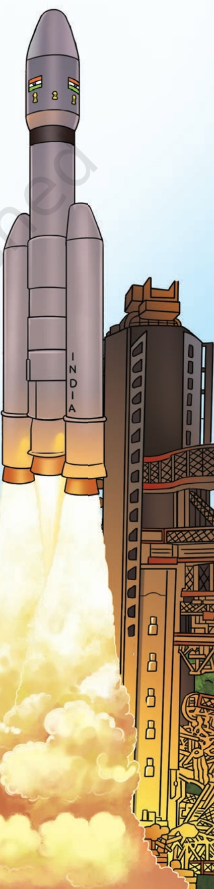
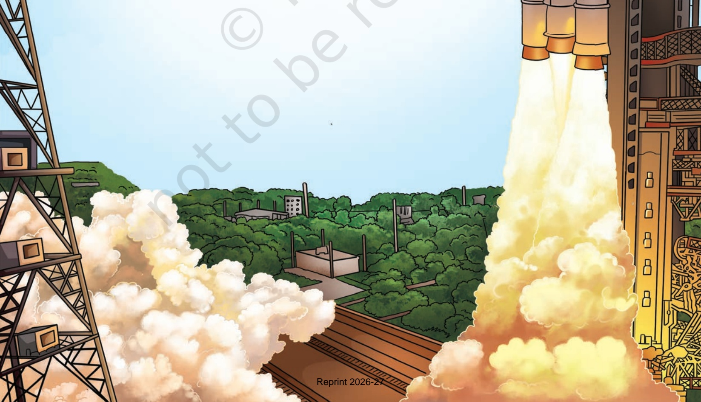

# It's Still Not the End, My Friend!

And once again, we’ve reached the last page of this book, and as we said earlier, it is certainly not the end of our curiosity — our jigyasa. We hope you’ve enjoyed the activities and experiments as you journeyed through the chapters. More importantly, we hope you asked a lot of questions! Now it is our time to ask you one.

Have you looked closely at the front and back covers of this science textbook? At first, they may just look like regular scenes from a playground or a running track, but if you observe carefully, you’ll find tiny hidden science clues connected to different chapters in the book! Take a closer look — maybe you will spot something related to what we discussed about motion or light, or maybe even about plants and animals?

Challenge yourself to find as many science links with the chapters as you can (we think there are more than 25!). And who knows — you might find connections that the authors and illustrators hadn’t even thought about! That is exactly how discoveries in science were made — by someone just observing something new, something unusual in the world around them.

This textbook is just a small guide, a map to find our way around the different paths of science. Never stop asking questions, and remember, your curiosity is the spark that lights the flame of exploration that will take you to incredible heights. And we’ll join you again, next year, for more adventures in science.

