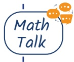

The squares of natural numbers are called **perfect squares.** For example, 1, 4, 9, 16, 25, … are all perfect squares.

## Patterns and Properties of Perfect Squares

Find the squares of the first 30 natural numbers and fill in the table below.

| 12 = 1 | 112 = 121 | 212 = 441 |
| --- | --- | --- |
| 22 = 4 | 122 = | 222= |
| 32 = 9 | 132 = |  |
| 42 = 16 | 142 = |  |
| 52 = 25 | 152 = |  |
| 62 = | 162 = |  |
| 72 = | 172 = |  |
| 82 = | 182 = |  |
| 92 = | 192 = |  |
| 102 = | 202 = |  |

What patterns do you notice? Share your observations and make conjectures.

Study the squares in the table above. What are the digits in the units places of these numbers? All these numbers end with 0, 1, 4, 5, 6 or 9. None of them end with 2, 3, 7 or 8.

If a number ends in 0, 1, 4, 5, 6 or 9, is it always a square?

The numbers 16 and 36 are both squares with 6 in the units place. 1 However, 26, whose units digit is also 6, is not a square. Therefore, we cannot determine if a number is a square just by looking at the digit in the units place. But, the units digit can tell us when a number is not a square. If a number ends with 2, 3, 7, or 8, then we can definitely say that it is not a square.

？ Write 5 numbers such that you can determine by looking at their units digit that they are not squares.

The squares, $1 ^ { 2 } , 9 ^ { 2 } , 1 1 ^ { 2 } , 1 9 ^ { 2 } , 2 1 ^ { 2 }$ and $2 9 ^ { 2 } ;$ all have 1 in their units place. Write the next two squares. Notice that if a number has 1 or 9 in the units place, then its square ends in 1.

？ Let us consider square numbers ending in 6: $1 6 = 4 ^ { 2 } ,$ $3 6 \: = \: 6 ^ { 2 }$ $1 9 6 = 1 4 ^ { 2 } ,$ $256 = 16^{2}, 576 = 24^{2}$ , and $6 7 6 = 2 6 ^ { 2 }$