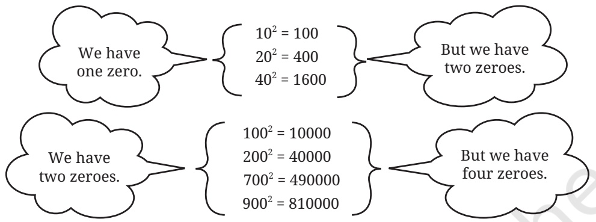
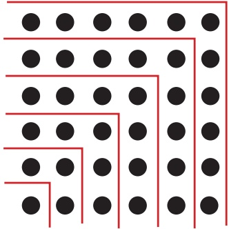

Which of the following numbers have the digit 6 in the units place? (i) $3 8 ^ { 2 }$ (ii) $3 4 ^ { 2 }$ (iii) $4 6 ^ { 2 }$ (iv) $5 6 ^ { 2 }$ (v) $7 4 ^ { 2 }$ (vi) $8 2 ^ { 2 }$

## ？ Find more such patterns by observing the numbers and their squares from the table you filled earlier.

Consider the following numbers and their squares.

？ If a number contains 3 zeros at the end, how many zeros will its square have at the end?

2 What do you notice about the number of zeros at the end of a number and the number of zeros at the end of its square? Will this always happen? Can we say that squares can only have an even number of zeros at the end?

？ What can you say about the parity of a number and its square?

## Perfect Squares and Odd Numbers

Let us explore the differences between consecutive squares. What do you notice?

$$
4-1=3 \quad 9-4=5 \quad 16-9=7 \quad 25-16=9
$$

See if this pattern continues for the next few square numbers.

From this we observe that adding consecutive odd numbers starting from 1 gives consecutive square numbers, as shown below.

$$
1 \div 3 = 4
$$

$$
1+3+5=9
$$

$$
1+3+5+7=16
$$

$$
1+3+5+7+9=25
$$

$$
1+3+5+7+9+11=36.
$$

