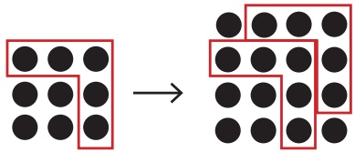
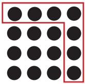

Do you remember this pattern from Grade 6? The picture below explains why each subsequent inverted L gives the next odd number:

1 + 3

1 + 3 + (3 + 2)

1 + 3 + 5

1 + 3 + 5 + (5 + 2)

1 + 3 + 5 + 7

We see that the sum of the first n odd numbers is $n ^ { 2 } ,$ Alternatively, every square is a sum of successive odd numbers starting from 1.

In mathematics, sometimes arguments and reasoning can be presented without any words. Visual proofs can be complete by themselves.

Also, we can find out whether a number is a perfect square by successively subtracting odd numbers. Consider the number 25, successively subtract 1, 3, 5, ... until you get or cross over 0,

25 – 1 = 24

24 – 3 = 21

21 – 5 = 16

16 – 7 = 9

9 – 9 = 0

This means 25 = 1 + 3 + 5 + 7 + 9 and is thus a perfect square. Since we subtracted the first five odd numbers, $2 5 = 5 ^ { 2 }$

Using the pattern above, find 362, given that $3 5 ^ { 2 }   =   1 2 2 5$

From the question we know that 1225 is the sum of the first 35 odd numbers. To find 362, we need to add the 36th odd number to 1225.

How do we find the 36th odd number?

The 1st odd number is 1, 2nd odd number is 3, 3rd number is 5, …, 6th odd number is 11 and so on.

What is the $n ^ { t h }$ odd number?

The $n ^ { t h }$ odd number is 2n–1.

Therefore, the 36th odd number is 71.

By adding 71 to 1225, we get 1296, which is $3 6 ^ { 2 }$

Consider a number such as 38 that is not a square and subtract consecutive odd numbers starting from 1.

38 – 1 = 37

$$
37 - 3 = 34
$$

29 – 7 = 22

22 – 9 = 13

13 – 11 = 2

2 – 13 = – 11

This shows that 38 cannot be expressed as a sum of consecutive odd numbers starting with 1.