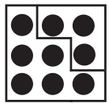
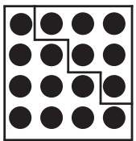

Thus, we can say that a natural number is not a perfect square if it cannot be expressed as a sum of successive odd natural numbers starting from 1. We can use this result to find out whether a natural number is a perfect square.

？ Find how many numbers lie between two consecutive perfect squares. Do you notice a pattern?

？ How many square numbers are there between 1 and 100? How many are between 101 and 200? Using the table of squares you filled earlier, enter the values below, tabulating the number of squares in each block of 100. What is the largest square less than 1000?

1 –100

101 – 200

201 – 300

301 – 400

401 – 500

501 – 600

601 – 700

701 – 800

801 – 900

901 – 1000

## Perfect Squares and Triangular Numbers

Do you remember triangular numbers?

1

3

6

10

15

？ Can you see any relation between triangular numbers and square numbers? Extend the pattern shown and draw the next term.

1 + 3 = 4 = 22

3 + 6 = 9 = 32

6 + 10 = 16 = 42

## Square Roots

？ The area of a square is 49 sq. cm. What is the length of its side? We know that $7 \times 7 = 4 9 _ { \mathrm { i } }$ , or $7 ^ { 2 } = 4 9$