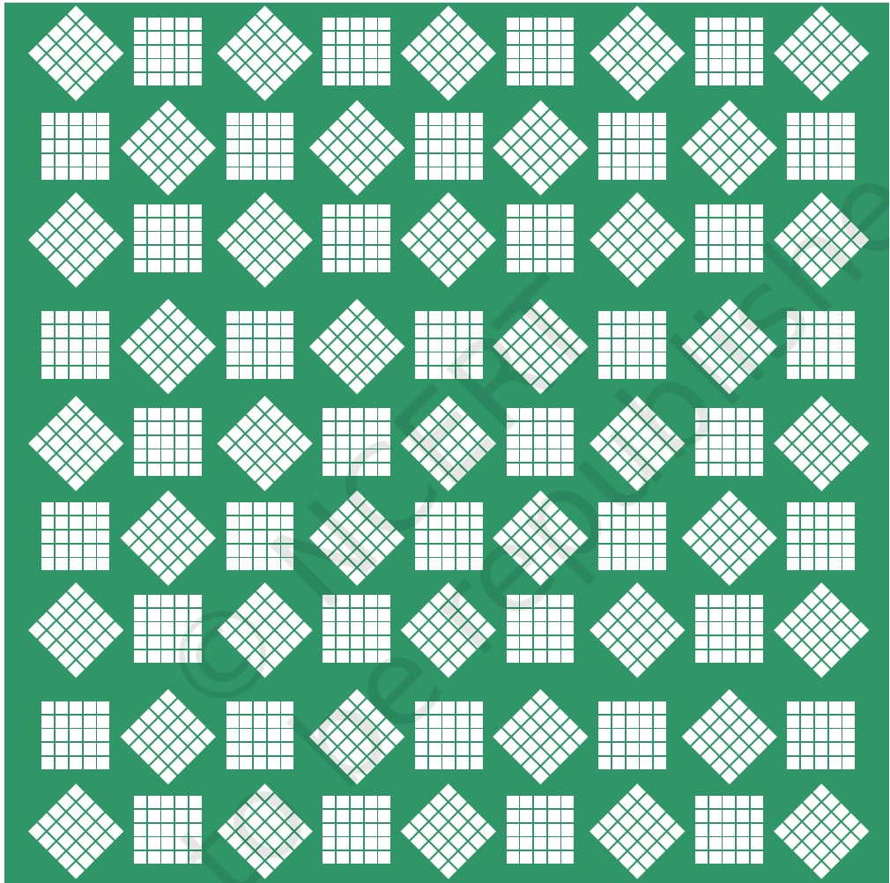
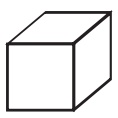
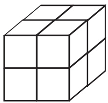

$$
1 ^ { 2 } + 2 ^ { 2 } + 2 ^ { 2 } = 3 ^ { 2 }
$$

$$
2 ^ { 2 } + 3 ^ { 2 } + 6 ^ { 2 } = 7 ^ { 2 }
$$

$$
3 ^ { 2 } + 4 ^ { 2 } + 1 2 ^ { 2 } = 1 3 ^ { 2 }
$$

$$
4 ^ { 2 } + 5 ^ { 2 } + 2 0 ^ { 2 } = ( \frac { \quad } { \quad } ) ^ { 2 }
$$

$$
9 ^ { 2 } + 1 0 ^ { 2 } + ( \frac { \quad } { \quad } ) ^ { 2 } = ( \frac { \quad } { \quad } ) ^ { 2 }
$$

9. How many tiny squares are there in the following picture? Write the prime factorisation of the number of tiny squares.

## 1.2 Cubic Numbers

You know the word **cube** from geometry. A cube is a solid figure all of whose all sides meet at right angles and are equal. How many cubes of side 1 cm make a cube of side 2 cm?

？ How many cubes of side 1 cm will make a cube of side 3 cm?