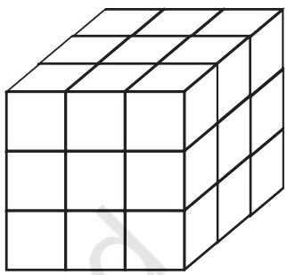
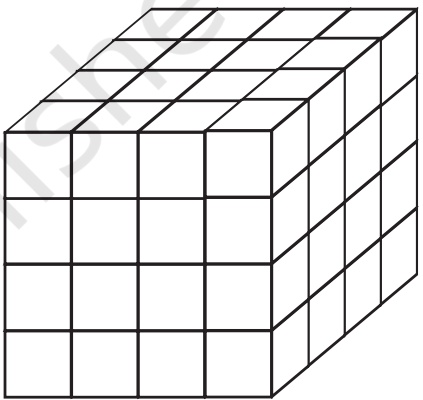

Consider the numbers 1, 8, 27, ...

These numbers are called **perfect cubes.** Can you see why they are named so?

Each of them is obtained by multiplying a number by itself three times. We note that

$$
1 = 1 \times 1 \times 1
$$

$$
8 = 2 \times 2 \times 2
$$

$$
2 7 = 3 \times 3 \times 3
$$

Is 9 a cube?

We see that $2 \times 2 \times 2 = 8$ and $3 \times 3 \times 3 = 2 7$ . This shows that 9 is not a perfect cube. Nor is any number from 10 to 26.

? Can you estimate the number of unit cubes in a cube with an edge length of 4 units?

It has 64 unit cubes! If you notice carefully, each layer of this cube has $4 \times 4$ unit cubes. Each square layer has 16 unit cubes $( 4 \times 4 )$ , and there are 4 such layers, so the total number of unit cubes is $4 \times 4 \times 4 = 64.$

Since $5^{3} = 5 \times 5 \times 5 = 125,$ , 125 is a cube.

**In general, for any number n, we write the cube** $\pmb { n } \times \pmb { n } \times \pmb { n }$ as $n ^ { 3 } .$

## ？ Complete the table below.

$$
1 ^ { 3 } = 1
$$

$$
1 1 ^ { 3 } = 1 3 3 1
$$

$$
2^{3} = 8
$$

$$
1 2 ^ { 3 } =
$$

$$
3 ^ { 3 } = 2 7
$$

$$
13^{3} = 2197
$$

$$
4 ^ { 3 } = 6 4
$$

$$
1 4 ^ { 3 } = 2 7 4 4
$$

$$
5 ^ { 3 } = 1 2 5
$$

$$
15^{3} =
$$

$$
6^{3} \equiv
$$

$$
1 6 ^ { 3 } =
$$

$$
7 ^ { 3 } =
$$

$$
1 7 ^ { 3 } = 4 9 1 3
$$

$$
8^{3}  三
$$

$$
1 8 ^ { 3 } = 5 8 3 2
$$

$$
\mathbf { \hat { 9 } } ^ { 3 } =
$$

$$
1 9 ^ { 3 } = 6 8 5 9
$$

$$
1 0 ^ { 3 } =
$$

$$
2 0 ^ { 3 } =
$$

？ What patterns do you notice in the table above?

We know that 0, 1, 4, 5, 6, 9 are the only last digits possible for