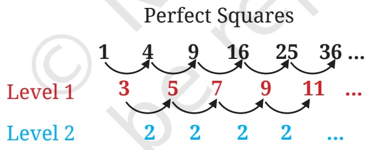
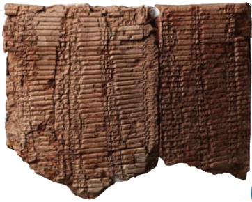

**Prime Factorisation of a Number**

**Prime Factorisation of its Cube**

$$
4 = 2 \times 2
$$

$$
4^{3}=64=2\times 2\times 2\times 2\times 2\times 2=2^{3}\times 2^{3}
$$

$$
6 = 2 \times 3
$$

$$
6^{3}=216=2\times 2\times 2\times 3\times 3\times 3=2^{3}\times 3^{3}
$$

$$
1 5 = 3 \times 5
$$

$$
1 5 ^ { 3 } = 3 3 7 5 = 3 \times 3 \times 3 \times 5 \times 5 \times 5 = 3 ^ { 3 } \times 5 ^ { 3 }
$$

$$
1 2 = 2 \times 2 \times 3
$$

$$
12^{3}=1728=2\times 2\times 2\times 2\times 2\times 2\times 3\times 3\times 3 \\ =2^{3}\times 2^{3}\times 3^{3}
$$

the prime factorisation of its cube.

## ? Find the cube roots of these numbers:

(i) $\sqrt[3]{64} =$

(ii) $\sqrt[3]{512} =$

(iii) $\sqrt [ 3 ] { 7 2 9 }$

## Successive Differences

We know that the differences between consecutive perfect squares gives the sequence of odd numbers. Observe the figure below where the differences are computed successively for perfect squares. After two levels, all the differences are the same.

？ Compute successive differences over levels for perfect cubes until all the differences at a level are the same. What do you notice?

Perfect Cubes

1 8 **27 64 125 216 ...**

## 1.3 A Pinch of History

The first known list of perfect squares and perfect cubes was compiled by the Babylonians as far back as 1700 BCE. These lists, found on clay tablets, were used to quickly find square roots and cube

