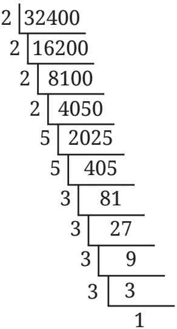

$n \times n \times n = n ^ { 3 }$ (read as ‘n cubed’ or ‘n raised to the power 3’)

$n \times n \times n \times n = n ^ { 4 }$ (read as ‘n raised to the power $4 ^ { \circ }$ or ‘the 4th power of n’) $n \times n \times n \times n \times n \times n \times n = n ^ { 7 }$ (read as $^ { \circ } n$ raised to the power $7 ^ { \circ }$ or ‘the 7th power of n’) and so on.

In general, we write $n ^ { a }$ to denote n multiplied by itself a times.

$$
5^{4} = 5 \times 5 \times 5 \times 5 = 625.
$$

$5 ^ { 4 }$ is the exponential form of 625. Here, 4 is the **exponent/power,** and 5 is the **base.** Exponents of the form $5 ^ { \overline { { n } } }$ are called powers of $5 : 5 ^ { 1 } ,   5 ^ { 2 } ,   5 ^ { 3 } ,   5 ^ { 4 }$ , etc. $2 \times 2 \times 2 \times 2 \times 2 \times 2 \times 2 \times 2 \times 2 \times 2 = 2^{10} = 1024.$ Remember the 1024 from earlier? There, it meant that after every 10 folds, the thickness increased 1024 times.

$5 ^ { 4 }$ is read as ‘5 raised to the power 4’ or ‘5 to the power 4’ or ‘5 power 4’ or ‘4th power of 5’

？ Which expression describes the thickness of a sheet of paper after it is folded 10 times? The initial thickness is represented by the letter-number v. (i) $1 0 v$ (ii) $1 0 \pm \nu$ (iii) $2 \times 10 \times v$ (iv) $2 ^ { 1 0 }$ (v) $2 ^ { 1 0 } \mathcal { V }$ (vi) $1 0 ^ { 2 } \bar { \nu }$

Some more examples of exponential notation: $4 \times 4 \times 4 = 4^{3} = 64.$ (– 4) × (– 4) × (– 4) = (– 4)3= – 64. Similarly,

$a \times a \times a \times b \times b$ can be expressed as $a ^ { 3 } b ^ { 2 }$ (read as a cubed b squared). $a \times a \times b \times b \times b \times b$ can be expressed as $\overline{a^{2}b^{4}}$ (read as a squared b raised to the power 4).

Remember that $4+4+4=3\times4=12.$ , whereas $4 \times 4 \times 4 = 4^{3} = 64.$

## ？ Express the number 32400 as a product of its prime factors and represent the prime factors in their exponential form.

$$
3 2 4 0 0 = 2 \times 2 \times 2 \times 2 \times 5 \times 5 \times 3 \times 3 \times 3 \times 3 .
$$

In exponential form, this would be

$$
32400 = 2^{4} \times 5^{2} \times 3^{4}
$$

？ What is $(-1)^{5}2$ Is it positive or negative? What about $( - 1 ) ^ { 5 6 } ?$

？ Is $( - 2 ) ^ { 4 } = 1 6 ? \mathrm { V e r i f y } .$

What is $0 ^ { 2 } , 0 ^ { 5 } ?$ What is 0n ?

## Figure it Out

1. Express the following in exponential form:

(i) $6 \times 6 \times 6 \times 6$ (ii) $y \times y$ (iii) $b \times b \times b \times b$ (iv) $5 \times 5 \times 7 \times 7 \times 7$ (v) $2 \times 2 \times a \times a$ (vi) $a \times a \times a \times c \times c \times c \times c \times d$