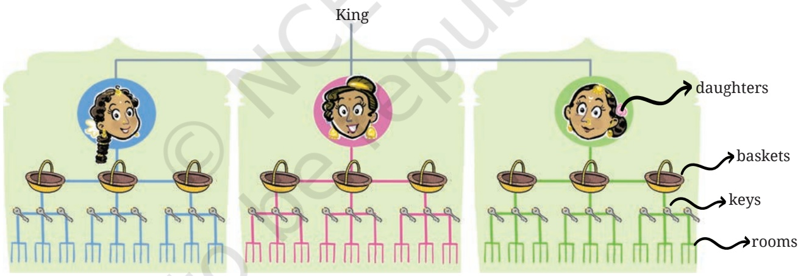

2. Express each of the following as a product of powers of their prime factors in exponential form. (i) 648 (ii) 405 (iii) 540 (iv) 3600

3. Write the numerical value of each of the following: (i) $2 \times 1 0 ^ { 3 }$ (ii) $7 ^ { 2 } \times 2 ^ { 3 }$ (iii) 3 $\times   4 ^ { 4 }$ (iv) $( - 3 ) ^ { 2 } \times ( - 5 ) ^ { 2 }$ (v) $3 ^ { 2 } \times 1 0 ^ { 4 }$ (vi) (– $2 ) ^ { 5 } \times ( - 1 0 ) ^ { 6 }$

## The Stones that Shine ...

？ Three daughters with curious eyes, Each got three baskets—a kingly prize. Each basket had three silver keys, Each opens three big rooms with ease. Each room had tables—one, two, three, With three bright necklaces on each, you see. Each necklace had three diamonds so fine… Can you count these stones that shine? **Hint:** Find out the number of baskets and rooms.

## How many rooms were there altogether?

The information given can be visualised as shown below.

From the diagram, the number of rooms is $3 ^ { 4 } .$ This can be computed by repeatedly multiplying 3 by itself,

$$
3 \times 3 = 9 .
$$

$$
9 \times 3 = 2 7 .
$$

$$
2 7 \times 3 = 8 1 .
$$

$$
8 1 \times 3 = 2 4 3 .
$$

？ How many diamonds were there in total? Can we find out by just one multiplication using the products above? The number of diamonds is $3 \times 3 \times 3 \times 3 \times 3 \times 3 \times 3 = 3 ^ { 7 } .$