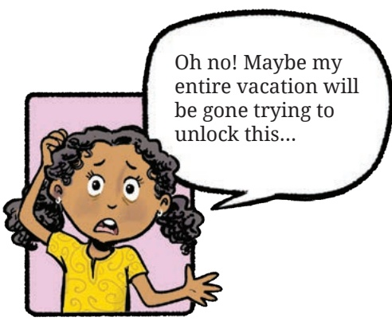
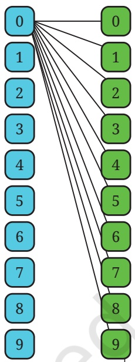

How many 5-digit passwords are possible?

Each digit has 10 choices, so a 5-digit lock will have:

$10 \times 10 \times 10 \times 10 \times 10 = 10^{5}$ $^ { = 1 , 0 0 , 0 0 0 }$ passwords. This is the same as writing numbers till 99,999 with all 5 digits, i.e., 00000, 00001, 00002, …00010, 00011, …, 00100, 00101, …, 00999, …, 30456, …, 99998, 99999.

Estu says, “Next time, I will buy a lock that has 6 slots with the letters A to Z. I feel it is safer.”

How many passwords are possible with such a lock?

？ Think about how many combinations are possible in different contexts. Some examples are—

Try This

(i) Pincodes of places in India—The Pincode of Vidisha in Madhya Pradesh is 464001. The Pincode of Zemabawk in Mizoram is 796017.

(ii) Mobile numbers.

(iii) Vehicle registration numbers.

Try to find out how these numbers or codes are allotted/generated.

## 2.3 The Other Side of Powers

Imagine a line of length 16 units. Erasing half of it would result in

$$
2^{4} \div 2 = \frac{2 \times 2 \times 2 \times 2}{2} = 2 \times 2 \times 2 = 2^{3} = 8   units.
$$

Erasing half one more time would result in,

$$
(2^{4} \div 2) \div 2 = 2^{4} \div 2^{2} = \frac{2 \times 2 \times 2 \times 2}{2 \times 2} = 2 \times 2 = 2^{2} = 4   units.
$$

Halving 16 cm three times may be written as,

$$
2^{4} \div 2^{3} = \frac{2 \times 2 \times 2 \times 2}{2 \times 2 \times 2} = 2 = 2^{1} = 2   units.
$$

From this we can see that

$$
2^{4} \div 2^{3} = 2^{4 - 3} = 2^{1}.
$$

## ？ What is $2 ^ { 1 0 0 } \div 2 ^ { 2 5 }$ in powers of 2?

In a generalised form,

$$
n ^ { a } \div n ^ { b } = n ^ { a   -   b } ,
$$

where $n \neq 0$ and a and b are counting numbers and $a \geq b$