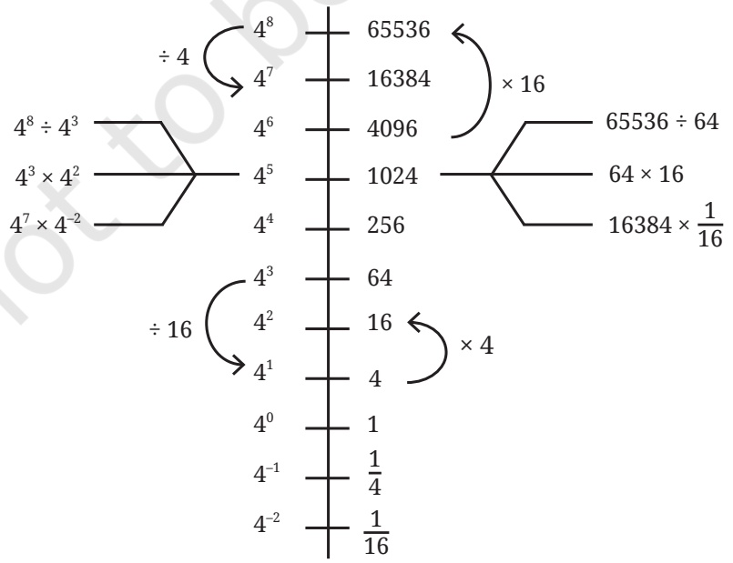

Similarly, $10^{-3} = \frac{1}{10^{3}}, 7^{-2} = \frac{1}{7^{2}}$ , etc.

Can we write $1 0 ^ { 3 } = \frac { 1 } { 1 0 ^ { ^ { - 3 } } }   ?$ We can write,

$$
\frac{1}{10^{-3}} = \frac{1}{1/10^{3}} = 1 \div \frac{1}{10^{3}} = 1 \times 10^{3} = 10^{3}.
$$

Similarly, $\nabla ^ { 2 } = { \frac { 1 } { 7 ^ { -   2 } } }$ and $4 ^ { a } = { \frac { 1 } { 4 ^ { - a } } }$

In a generalised form,

$n ^ { -   a } = { \frac { 1 } { n ^ { a } } }$ and $n ^ { a } = { \frac { 1 } { n ^ { - a } } }$ , where $n \neq 0$

Math Talk

Consider the following general forms we have identified.

| $n^{a} \times n^{b} = n^{a + b}$ | $( n ^ { a } ) ^ { b } = ( n ^ { b } ) ^ { a } = n ^ { a \times b }$ | $n^{a} \div n^{b} = n^{a - b}$ |
| --- | --- | --- |

？ We had required a and b to be counting numbers. Can a and b be any integers? Will the generalised forms still hold true?

Write equivalent forms of the following. (i) 2– 4 (ii) $1 0 ^ { - 5 }$ $( = 7 ) ^ { - 2 }$ (iv) $( - 5 ) ^ { -   3 }$ (v) $1 0 ^ { - 1 0 0 }$

? Simplify and write the answers in exponential form. (i) $2 ^ { - 4 } \times 2 ^ { 7 }$ (ii) $3^{2} \times 3^{-5} \times 3^{6}$ (iii) $p ^ { 3 } \times p ^ { - 1 0 }$ (iv) $2 ^ { 4 }   \times \left( - 4 \right) ^ { - 2 }$ (v) $8 ^ { p } \times 8 ^ { q }$

## Power Lines

Let us arrange the powers of 4 along a line.

