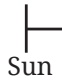

number written in scientific form is the exponent, and then the first digit of the coefficient. The digits following the coefficient are small corrections to the first digit.

most of the time, they serve the purpose at hand.

The distance between the Sun and Saturn is 14,33,50,00,00,000 m $1 . 4 3 3 5 \times 1 0 ^ { 1 2 }   \mathrm { m }$

The distance between Saturn and Uranus is 14,39,00,00,00,000 m $= 1 . 4 3 9 \times 1 0 ^ { 1 2 }$ m. The distance between the Sun and Earth is $1 , 4 9 , 6 0 , 0 0 , 0 0 , 0 0 0 \; \mathrm { m } = 1 . 4 9 6 \times 1 0 ^ { 1 1 } \; \mathrm { m }$

## ？ Can you say which of the three distances is the smallest?

？ The number line below shows the distance between the Sun and Saturn $( 1 . 4 3 3 5 \times 1 0 ^ { 1 2 }   \mathrm { m } )$ . On the number line below, mark the relative position of the Earth. The distance between the Sun and the Earth is $\bar{1.496 \times 10^{11}}$ m.

？ Express the following numbers in standard form. (i) 59,853 (ii) 65,950 (iii) 34,30,000 (iv) 70,04,00,00,000