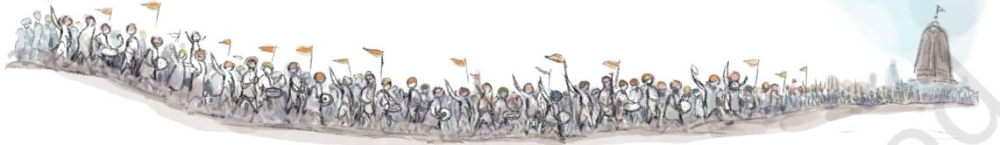

Pādayātra, is the traditional practice of walking long distances as part of a religious or spiritual pursuit. People across religions in our country observe similar forms of pilgrimage or spiritual walking, although they may have different names or purposes.

Some of the pilgrimages are Ajmer Sharif Dargah Ziyarat, Pandharpur Wari, Kānwar Yatra, Sabarimala Yatra, Sammed Shikharji Yatra, Lumbini to Sarnath Yatra.

Before the rise of modern transport, people moved from one place to another by walking — sometimes merchants, sages, and scholars walked thousands of kilometres to different parts of the world across deserts, mountains, and rivers.

？ How many times can a person circumnavigate (go around the world) the Earth in their lifetime if they walk non-stop? Consider the distance around the Earth as 40,000 km.

## Linear Growth vs. Exponential Growth

R i t ll E t b t i nce-fiction novel she is reading where they ox e e s s u a ou a sc e b ild  l dd h u a a er to reac

the moon, “... I wonder if we actually had a ladder like that, how many steps would it have?”.

## ？ What do you think? Make an instinctive guess first.

## Would the number of steps be in thousands, lakhs, crores, or even more?

To find out, we would

need to know the gap between consecutive steps of the ladder. Let’s assume a reasonable distance of 20 cm. Visualising the problem as shown,