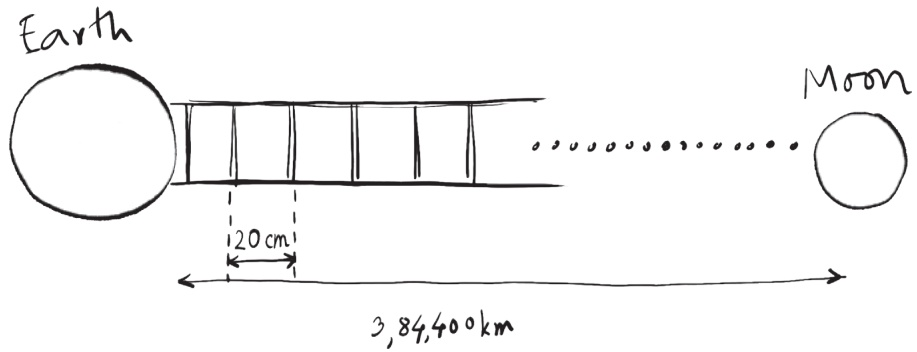
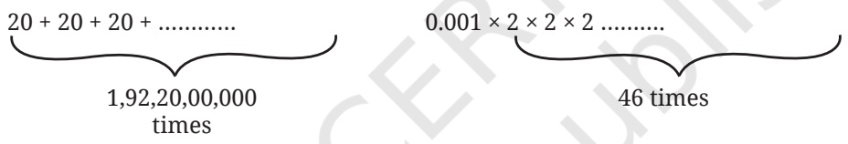

We have to find out how many 20 cm make 3,84,400 km.

If we calculate the value, we get the result as 1,92,20,00,000 steps, which is 192 crore and 20 lakh steps or 1 billion 922 million steps. The fixed each step) is called **linear growth.**

To cover the distance between the Earth and the Moon, it takes 1,92,20,00,000 steps with linear growth whereas it takes just 46 folds of a piece of paper with exponential growth! Linear growth is additive, whereas exponential growth is multiplicative.

Some examples of exponential growth we have seen earlier in this chapter are ‘The Stones that Shine’, ‘Magical Pond’, ‘How Many Combinations’. We shall explore more such interesting examples in a later chapter and also in the next grade.

？ Can you come up with some examples of linear growth and of exponential growth?

## Getting a Sense for Large Numbers

Last year, we learnt about lakhs and crores, as well as millions and billions. A lakh is 105 (1,00,000), a crore is 107 (1,00,00,000), and an arab is 109 (1,00,00,00,000), whereas a million is 106 (1,000,000) and a billion is 109 (1,000,000,000).

You might know the size of the world’s human population. Have you ever wondered how many ants there might be in the world or how long ago humans emerged? In this section, we shall explore numbers significantly larger than arabs and billions. We shall use powers of 10 to represent and compare these numbers in each case.

100 As of mid-2025, there are only two northern white rhinos remaining in the world, both females, and they reside at the Ol Pejeta Conservancy in Kenya (= 2 × 100).