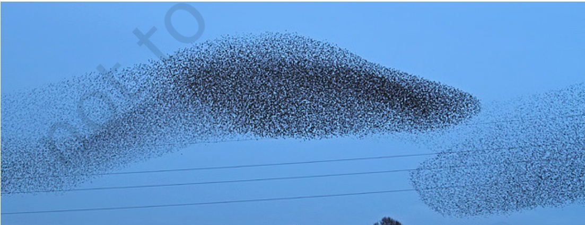

$1 0 ^ { 1 }$ As of early 2024, the total population of Hainan gibbons is a meagre $4 2 ^ { ^ { \circ } } ( \approx 4 \times 1 0 ^ { 1 } )$

$1 0 ^ { 2 }$ There are just 242 Kakapo alive as of mid-2025 (≈ 2 × 102).

$1 0 ^ { 3 }$ There are fewer than 3000 Komodo dragons in the world, all based in Indonesia $( \approx 3 \times 1 0 ^ { 3 } )$ .

104 A 2005 estimate of the maned wolf population showed that there are more than 17000 of them; most are located in Brazil (1.7 × 104).

$1 0 ^ { 5 }$ As of 2018, there are around 4.15 lakh African elephants $( \approx 4 \times 1 0 ^ { 5 } )$

$1 0 ^ { 6 }$ There are an estimated 50 lakh / 5 million American alligators as of 2025 (5 × 106).

107 The global camel population is estimated to be over 3.5 crore/ 35 million $( 3 . 5   \times   \bar { 1 } 0 ^ { \bar { 7 } } )$ . India has only about 2.5 lakhs of them. The global horse population is around 5.8 crore / 58 million $( 5 . 8 \bar { \times 1 0 ^ { 7 } } )$ , with about half of them in America.

$1 0 ^ { 8 }$ More than 20 crore / 200 million $( 2   \times   1 0 ^ { 8 } )$ water buffaloes are estimated worldwide, with a vast majority of them in Asia.

109 The estimated global population of starlings is around 1.3 arab/1.3 billion $( \frown )$ . The global human population as of 2025 is 8.2 arab/8.2 billion $( 8 . 2 \times \bar { 1 } 0 ^ { 9 } )$

A picture of a starling murmuration over a farm in the UK. Starling murmuration is a mesmerising aerial display of thousands of starlings flying in synchronised, swirling patterns. It is often described as a ‘choreographed dance’.