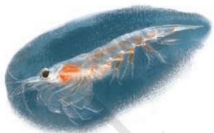
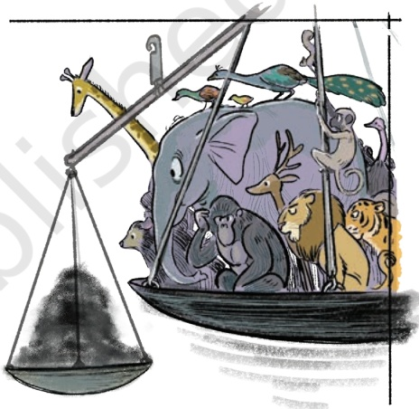

？ With a global human population of about $8   \times   1 0 ^ { 9 }$ and about $4   \times   1 0 ^ { 5 }$ African elephants, can we say that there are nearly 20,000 people for every African elephant?

$1 0 ^ { 1 0 }$ The global chicken population living at any time is estimated at ≈ 33 billion $( 3 . 3 \times 1 \bar { 0 ^ { 1 0 } } )$

$1 0 ^ { 1 2 }$ The estimated number of trees (2023) globally stands at 30 kharab/3 trillion $( 3   \times   1 0 ^ { 1 2 } )$ . One kharab is 100 arab, and one trillion is 1000 billion.

1014 The estimated mosquito population worldwide (2023) is 11 neel/110 trillion ( \_). A derived estimate of the population of the Antarctic krill stands at 50 neel/500 trillion $( 5 \times 1 0 ^ { 1 4 } )$

1015 An estimate of the beetle population stands at 1 padma/1 quadrillion $( 1 ~ \times ~ 1 0 ^ { 1 5 } )$ . The estimate of the earthworm population is also at 1 padma/1 quadrillion.

$1 0 ^ { 1 6 }$ The estimated population of ants globally is 20 padma/20 quadrillion $( 2 \times 1 0 ^ { \bar { 1 6 } } )$ . Ants alone outweigh all wild birds and wild mammals combined.

1021 is supposed to be the number of grains of sand on all beaches and deserts on Earth. This is enough sand to give every ant 10 little sand castles to live in.

$1 0 ^ { 2 3 }$ The estimated number of stars in the observable universe is $2 \times 1 0 ^ { 2 3 }$

$1 0 ^ { 2 5 }$ There are an estimated $2 \times 1 0 ^ { 2 5 }$ drops of water on Earth (assuming 16 drops per millilitre).

？ Calculate and write the answer using scientific notation:

(i) How many ants are there for every human in the world?

(ii) If a flock of starlings contains 10,000 birds, how many flocks could there be in the world?