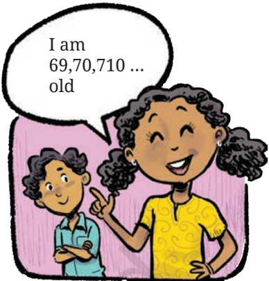

(iii) If each tree had about $1 0 ^ { 4 }$ leaves, find the total number of leaves on all the trees in the world.

(iv) If you stacked sheets of paper on top of each other, how many would you need to reach the Moon?

## A different way to say your age!

“How old are you?” asked Estu.

“I completed 13 years a few weeks $\mathtt { a g o l ^ { \flat } }$ said Roxie.

“How old are you?” asked Estu again.

“I’m 4840 days old today!” said Roxie.

“How old are you?” asked Estu again.

“I’m hours old!” said Roxie.

Make an estimate before finding this number.

Estu: “I am 4070 days old today. Can you find out my date of birth?”

What could this number mean? Find out!

## ？ If you have lived for a million seconds, how old would you be?

We shall look at approximate times and timelines of some events and phenomena, and use powers of 10 to represent and compare these quantities.

| Time in seconds | Comparison to real-world events/phenomena |
| --- | --- |
| $1 0 ^ { 0 } = 1$ second | Time taken for a ball thrown up to fall back on the ground (typically a few seconds). |
| $1 0 ^ { 1 } = 1 0$ seconds | Time blood takes to complete one full circulation $( 1 \times 1 0 ^ { 1 } - 2 \times 1 0 ^ { 1 }$ through the body: 10-20 seconds seconds). Typical waiting time at a traffic signal. |

Isn’t it quite amazing how someone is able to estimate things like the number of ants in the world or the time blood takes to fully circulate? You may carry this wonder whenever you encounter such facts. You will come across such facts in subjects like Science and Social Science, where such estimates are made frequently.

$1 0 ^ { 2 }$ seconds

${ \approx } 1$ .6 minutes

\- Time needed to make a cup of tea: 5–10 minutes $( \approx 4 \times 1 0 ^ { 2 } - 8 \times 1 0 ^ { 2 }$ seconds).

Time for light to reach the Earth from the Sun: about 8 minutes $\bar { ( } \approx 5 \times 1 0 ^ { 2 }$ seconds).