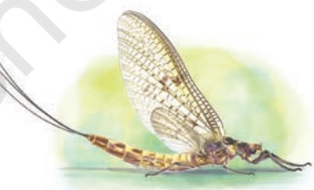
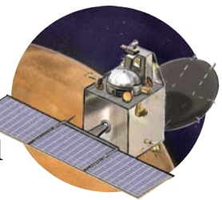

## $1 0 ^ { 3 }$ seconds $\approx 1 6 . 6$ minutes

Satellites in low Earth orbits take between 90 minutes $( \approx 5 . 5 \times 1 0 ^ { 3 }$ seconds) to 2 hours to complete one full revolution around the Earth.

$1 0 ^ { 4 }$ seconds $\approx 2 . 7$ hours

\- The time needed to digest a meal: about $2   -   4$ hours to pass through the stomach.

Lifespan of an adult mayfly: about a day $( \approx 9 \stackrel { - } { \times } 1 0 ^ { 4 }$ seconds).

？ $1 0 ^ { 5 }$ seconds ≈ 1.16 days and $1 0 ^ { 6 }$ seconds ≈ 11.57 days. Think of some events or phenomena whose time is of the order of (i) $1 0 ^ { 5 }$ seconds and (ii) $1 0 ^ { 6 }$ seconds. Write them in scientific notation.

$1 0 ^ { 7 }$ seconds ≈ 115.7 days / $\approx 3 . 8$ months

-Time spent sleeping in a year: about 4 months.

Time taken by Mangalyaan mission to reach Mars: 298 days $( \approx 2 . 6 5 \times 1 0 ^ { 7 }$ seconds).

Time taken by Mars for one full revolution around the Sun: 687 Earth-days/1.88 Earth-years $\left( \approx 6 \times 10^{7} \right.$ seconds).

$1 0 ^ { 8 }$ seconds ≈ 3.17 years $1 0 ^ { 9 }$ seconds $\approx 3 1 . 7$ years

The typical lifespan of most dogs is 3 to 15 years.

The orbital period of Halley’s comet is 75–79 years; the next expected return is in the year 2061 $( \approx 2 . 4 \times 1 0 ^ { 9 }$ seconds).

Duration of one full revolution of Neptune around the Sun: 60,190 Earth-days/\~165 Earth-years or 89,666 Neptunian days/1 Neptunian-year $( \approx 5 . 2 \times 1 0 ^ { 9 }$ seconds). A day on Neptune is about 16.1 hours