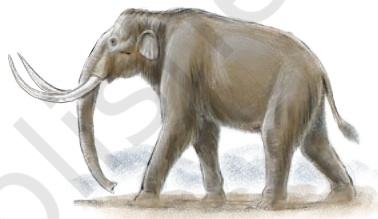
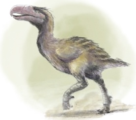

Notice how rapid exponential growth is $- 1 0 ^ { 6 }$ seconds is less than a fortnight, but $\bar { 1 } 0 ^ { 9 }$ seconds is a whopping 31 years (about half the life expectancy of a human)!

$1 0 ^ { 1 0 }$ seconds - The Chola dynasty ruled for more than 900 years $\approx 3 1 7$ years $( \approx 3 \times 1 0 ^ { 1 0 }$ seconds) between the 3rd Century BCE and 12th Century CE.

$1 0 ^ { 1 1 }$ seconds $\approx 3 { , } 1 7 0$ years

\- Age of the oldest known living tree: about 5000 years $\stackrel { \sim } { ( \approx 1 . 5 7 \times 1 0 ^ { 1 1 } }$ seconds).

Time since the last peak ice age: 19,000 – 26,000 years ago $( \approx 6 \times 1 0 ^ { 1 1 }$ seconds $- 8 . 2 \times \bar { 1 } 0 ^ { 1 1 }$ seconds).

$1 0 ^ { 1 2 }$ seconds $\approx 3 1 { , } 7 0 0$ years

Early Homo sapiens first appeared 2–3 lakh years ago $( \approx 7 \times 1 0 ^ { 1 2 } - 9 \times 1 0 ^ { 1 2 }$ seconds). The entire population around that time could fit in a large cricket stadium.

$1 0 ^ { 1 3 }$ seconds ≈ 3.17 lakh years

The Steppe Mammoth is estimated to have appeared around 8–18 lakh years ago.

$1 0 ^ { 1 4 }$ seconds $\approx 3 . 1 7$ million years

A fossil of Kelenken Guillermoi, a type of terror bird, is dated to 15 million years ago ( ≈ seconds).

$1 0 ^ { 1 5 }$ seconds $\approx 3 . 1 7$ crore years

\- Age of Himalayas: 5.5 crore years/55 million years (≈ 1.7 $\times   \bar { 1 } 0 ^ { 1 5 }$ seconds); they continue to grow a few mm every year.

Dinosaurs went extinct 6.6 crore years ago/66 million years ago $( \approx 2 \times 1 0 ^ { 1 5 }$ seconds).

Dinosaurs first appeared more than 20 crore/200 million years ago $( \approx 6 \times \bar { 1 0 ^ { 1 5 } }$ seconds).

It takes about 23 crore years for the Sun to make one complete trip around the Milky Way $( \approx 7 \times 1 0 ^ { 1 5 }$ seconds).