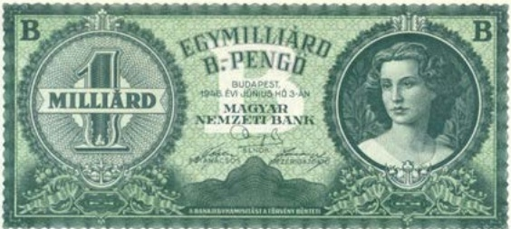
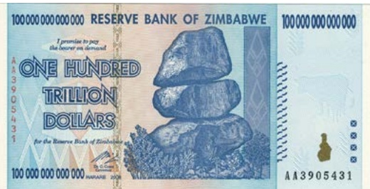

## Figure it Out

1. Find out the units digit in the value of $2^{224} \div 4^{32} ?$ [Hint: $4 = 2 ^ { 2 } ]$

2. There are 5 bottles in a container. Every day, a new container is brought in. How many bottles would be there after 40 days?

3. Write the given number as the product of two or more powers in three different ways. The powers can be any integers. (i) $6 4 ^ { 3 }$ (ii) $1 9 2 ^ { 8 }$ (iii) $3 2 ^ { - 5 }$

4. Examine each statement below and find out if it is ‘Always True’, ‘Only Sometimes True’, or ‘Never True’. Explain your reasoning.

(i) Cube numbers are also square numbers.

(ii) Fourth powers are also square numbers.

(iii) The fifth power of a number is divisible by the cube of that number.

(iv) The product of two cube numbers is a cube number.

(v) $q ^ { 4 6 }$ is both a 4th power and a 6th power (q is a prime number).

5. Simplify and write these in the exponential form. (i) $1 0 ^ { - 2 } \times 1 0 ^ { - 5 }$ (ii) $5 ^ { 7 } \div 5 ^ { 4 }$ (iii) $9 ^ { -   7 } \div 9 ^ { 4 }$ (iv) $( 1 3 ^ { -   2 } ) ^ { -   3 }$ (v) $m ^ { 5 } n ^ { 1 2 } ( m n ) ^ { 9 }$

6. If $1 2 ^ { 2 } = 1 4 4$ what is (i) $( 1 . 2 ) ^ { 2 }$ (ii) $( 0 . 1 2 ) ^ { 2 }$ (iii) $( 0 . 0 1 2 ) ^ { 2 }$ (iv) $1 2 0 ^ { 2 }$