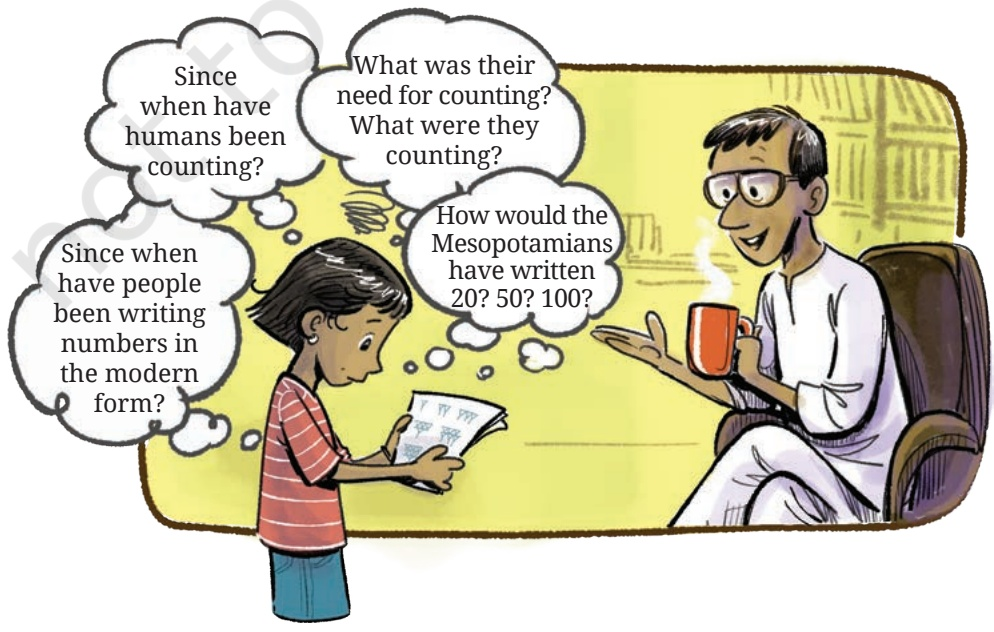

## 3.1 Reema’s Curiosity

One lazy afternoon, Reema was flipping through an old book when— whoosh!—a piece of paper slipped out and floated to the floor. She picked it up and stared at the strange symbols all over it. “What is this?” she wondered.

She ran to her father, holding the paper as if it were a secret treasure. He looked at it and smiled. “Around 4000 years ago, there flourished a civilisation in a region called Mesopotamia, in the western part of Asia, containing a major part of the present-day Iraq and a few other neighbouring countries. This is one of the ways they wrote their numbers!”

Reema’s eyes lit up, “Seriously? These strange symbols were numbers?” Her curiosity was sparked, and questions started swirling in her head.

Reprint 2026-27